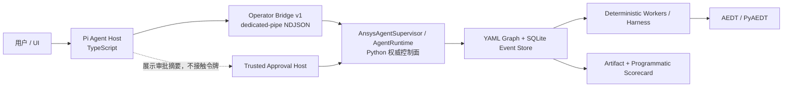

# 基于 Pi Agent SDK 构建 ansys-agent：研究与分析报告

> **架构澄清（2026-07-26）**：Pi 不是本项目外加的“聊天观察器”，而是要替代
> Claude Code 一类重型通用 Agent 的**领域 Agent Host**：它持有 `pi-agent-core` 的
> Agent Loop、`pi-ai` provider、会话、流式输出和受限工具注册。现有 Python Harness、
> Graph Runtime、SQLite、审批与 AEDT 则继续是工程效果与状态的权威层。本文此前的
> “外层 Operator”表述仅描述第一段只读安全 PoC，现由这一目标解释取代。

> **架构复审（2026-07-26）**：当前 P0-P3 只读基础继续保留，但 P4 写入暂停。Pi Bridge 必须
> 复用现有 Runtime MCP/Harness 下方的共享 Python Tool Gateway，并先完成 operation 级响应 schema、
> durable command journal/runner、authoritative control digest、数据库 lease/fence、write grant、
> resource handle、persistent snapshot 和 Harness 恢复。否则“受控写入”只是 prompt 约束，不是系统保证。

## 文档信息

- 研究日期：2026-07-26
- 研究对象：Pi Agent Book、Pi 官方 SDK/安全/会话文档、Pi `v0.82.1` 包、当前 ansys-agent 仓库
- 目标：判断 Pi 应如何进入现有 ansys-agent，给出可落地的技术路线与采用门槛
- 结论状态：**有条件采用 PoC，不批准重写现有 Python Runtime**
- 配套文档：
- [目标架构规格](./architecture-spec.md)
- [实施计划](./implementation-plan.md)
- [P3 退出证据清单](./p3-exit-evidence.md)
- [P3 Windows SIGINT gate 设计](./p3-windows-signal-gate-design.md)

## 1. 执行摘要

Pi 适合成为 ansys-agent 的轻量 Agent Host，替代 Claude Code 一类通用编码 Agent 的
会话和 ReAct 工具循环；它不替换已经存在的任务编排、审批、恢复、仿真和工程判定内核。

推荐方案是：

1. 在 `integrations/pi-operator/` 建立一个独立的 TypeScript 应用。
2. 精确锁定 `@earendil-works/pi-agent-core@0.82.1` 和
   `@earendil-works/pi-ai@0.82.1`。
3. Pi 负责用户意图理解、模型/provider、Agent Loop、流式反馈、会话、上下文压缩和
   领域工具编排；这是新的 ansys-agent 交互运行时，不是旁路 UI。
4. Pi 只能调用少量 ansys-agent 高层控制工具，不能获得 `bash`、任意文件读写、
   PyAEDT 或 worker 直连能力。
5. Python 继续持有 Mission、GraphRun、Approval、Event、Artifact、Scorecard 和 AEDT
   生命周期的唯一权威状态。
6. TypeScript 与 Python 之间采用本机匿名管道上的版本化 NDJSON 协议：stdin 只承载请求，
   专用响应管道（首选子进程 fd 3）承载响应与事件；所有写操作必须带
   durable command receipt、`idempotency_key` 和 expected control version/digest。
7. 先跑只读影子模式，再逐项开放受控写操作；只有通过现有 A/B 评估门才正式采用。

这不是“把 Python Agent 改写成 TypeScript”，而是用 Pi 建立一个轻量、可恢复、可审计的
领域 Agent 骨架，并将成熟的 Python Harness 作为其唯一受控效果执行层。

## 1.1 当前 PoC 验证命令

`integrations/pi-operator` 已提供只读门禁执行器。它使用 faux Pi provider 依次观察至少 10 个
既有 `graph_run_id`，通过 fd 3 调用 Python bridge，并比较 SQLite 主文件及 sidecar 哈希。执行前
必须对 fixture 做 checkpoint、切换为 `journal_mode=DELETE` 并关闭所有写连接。

```powershell
$env:AEDT_AGENT_PYTHON = "C:/path/to/python.exe"
npm --prefix integrations/pi-operator run gate:readonly -- `
  --db C:/fixtures/recorded-missions.db `
  --graph-run-id <id-1> --graph-run-id <id-2> --graph-run-id <id-3> `
  --graph-run-id <id-4> --graph-run-id <id-5> --graph-run-id <id-6> `
  --graph-run-id <id-7> --graph-run-id <id-8> --graph-run-id <id-9> `
  --graph-run-id <id-10>
```

该命令只允许读操作；发现 SQLite sidecar、哈希变化、bridge 协议错误或 Pi 工具调用异常即失败，不能作为
写入阶段的替代审批。

### Provider 配置

Host 不会默认回退到任何外部模型。部署范围固定为 DeepSeek 官方 API，且只接受
`deepseek-v4-flash`。API key 不会写入
Session、telemetry、Bridge 环境或标准输出。

```powershell
# 固定官方 endpoint；不接受自定义 URL、模型或密钥变量。
$env:AEDT_AGENT_PI_PROVIDER = "deepseek"
$env:AEDT_AGENT_PI_MODEL = "deepseek-v4-flash"
# DEEPSEEK_API_KEY 已由受控本地 secret source 提供
```

`--model` 必须与 `AEDT_AGENT_PI_MODEL` 完全一致且均为 `deepseek-v4-flash`。provider adapter、规范化 base URL、model、
key 变量名与固定兼容性参数会组成 `provider_profile_digest`；同一 Pi Session 恢复时该摘要不一致即失败。

### 可信 stale lease 恢复

Host 被强杀后不会自动接管 Session。值班人员必须先确认 lock 中的 `pid` 已死亡、记录精确
`token`，再显式执行下列命令。token/session 不匹配、owner 仍存活、无法确认 owner 状态或 lock
在检查期间变化，都会拒绝删除。恢复过程会创建同一 Session 的 maintenance marker；所有 Host
acquire 在 marker 存在时失败关闭。恢复开始前仍必须停止该 Session 的 launcher/supervisor，避免
把恢复 API 当作并发接管机制。

```powershell
npm --prefix integrations/pi-operator run recovery:clear-stale-lease -- `
  --session-dir C:/aedt/operator-sessions `
  --session-id <session-id> `
  --lease-token <token-from-incident-record>
```

若 recovery 进程自身在 maintenance marker 创建后崩溃，Host 同样会拒绝启动；经升级审批后可将
最后一个参数改为 `--recovery-marker-token <marker-token>`。这不是自动接管路径。

## 2. 研究范围与方法

本报告交叉核对了三类证据：

| 证据 | 用途 | 可信度处理 |
|---|---|---|
| [Pi Agent Book 第 1-10 章](https://dg-ai-notes.pages.dev/modules/ch01-overview/) | 理解分层、Agent Loop、工具、事件、上下文与 Session 的设计意图 | 二手教程；按其声明的 `v0.80.2` 解读 |
| [Pi 官方 SDK 文档](https://pi.dev/docs/latest/sdk)、[安全文档](https://pi.dev/docs/latest/security)、[agent-core README](https://github.com/earendil-works/pi/blob/main/packages/agent/README.md) | 核对当前 API、权限边界与正式能力 | 作为当前事实来源 |
| 当前 ansys-agent 代码、测试与架构文档 | 判断可复用能力、状态所有权和接入成本 | 以本仓库实现为准 |

因此，教程用来提炼设计思想，官方资料用来确定实现事实，仓库代码用来决定集成边界。
教程示例与当前官方 API 冲突时，以固定版本的官方包和本项目契约测试为准。

## 3. 对目标网站的系统解读

### 3.1 十章内容与本项目的对应关系

| 章节 | Pi 的核心思想 | 对 ansys-agent 的直接启示 |
|---|---|---|
| [第 1 章：总览](https://dg-ai-notes.pages.dev/modules/ch01-overview/) | Pi 同时是编码产品、学习材料和 SDK；强调可塑性 | 使用 SDK 构建领域操作员，不照搬默认编码 Agent |
| [第 2 章：三层架构](https://dg-ai-notes.pages.dev/modules/ch02-three-layer-arch/) | `pi-ai -> pi-agent-core -> pi-coding-agent`，TUI 正交 | 领域层优先选 `pi-ai + pi-agent-core`，避免引入无关编码工具 |
| [第 3 章：Agent Loop](https://dg-ai-notes.pages.dev/modules/ch03-agent-loop/) | ReAct、Turn、Trace、steering、follow-up、停止条件 | Pi 负责对话循环；YAML Graph 仍负责工程执行循环 |
| [第 4 章：模型调用](https://dg-ai-notes.pages.dev/modules/ch04-model-call/) | 统一 provider、流事件、token/成本 | 可把现有外层聊天的 provider 差异收敛到 `pi-ai` |
| [第 5 章：工具系统](https://dg-ai-notes.pages.dev/modules/ch05-tools/) | schema、前后钩子、错误消息化、并发控制 | 用 schema 和 hook 做工具白名单、脱敏、审计；写工具强制串行 |
| [第 6 章：消息系统](https://dg-ai-notes.pages.dev/modules/ch06-messages/) | AgentMessage 与 LLM Message 分层、上下文转换 | UI/审计事件不必全部进入模型，上下文只保留有决策价值的摘要 |
| [第 7 章：事件驱动](https://dg-ai-notes.pages.dev/modules/ch07-event-driven/) | 生命周期事件、同步屏障、扩展隔离 | 把 Pi event 映射为观察数据，而不是再造 Python Event Store |
| [第 8 章：上下文工程](https://dg-ai-notes.pages.dev/modules/ch08-context-engineering/) | 工具截断、动态 prompt、Skills、上下文裁剪 | Graph 状态必须有 bounded view；原始曲线与大 payload 不进 LLM |
| [第 9 章：压缩](https://dg-ai-notes.pages.dev/modules/ch09-compaction/) | reserve token、结构化摘要、增量压缩 | 压缩对话历史，但每次恢复都重新读取 Python 权威状态 |
| [第 10 章：会话](https://dg-ai-notes.pages.dev/modules/ch10-session/) | append-only JSONL Session Tree、恢复与分叉 | Pi Session 可记录交互分支，但不能充当 Mission 恢复日志 |

### 3.2 最值得借鉴的设计

**窄内核，复杂性放在边界。**
Pi 把模型翻译、工具钩子、消息转换、事件消费者和会话持久化放在明确边界上，
Agent Loop 本身保持小而透明。ansys-agent 也已经把 Graph、worker、artifact 和审批
分层，因此两者适合通过控制协议组合，而不是互相侵入。

**工具错误成为可观察结果。**
参数错误、工具不存在、权限拦截和执行异常最终都能作为结构化结果反馈给模型。对本项目
而言，这意味着 bridge 不应把 Python traceback 直接扔进对话，而应返回稳定错误码、
可恢复性和下一步允许动作。

**上下文不是数据库。**
Pi 的截断、压缩和分支摘要都说明模型上下文天然有损。Mission 恢复必须依赖 SQLite、
Event Replay 和 Graph 状态，不能依赖模型“记得上次做到哪里”。

**事件用于可观测，不自动取得控制权。**
Pi 生命周期事件非常适合做流式 UI、token/cost、tool trace 和诊断；工程事实仍来自
ansys-agent 的事件与 scorecard。

### 3.3 教程不能直接当作实施规范的地方

1. 教程基于 `v0.80.2`，本次研究时官方包已到 `v0.82.1`，SDK 初始化 API 已发生变化。
2. 网站的 Python 切换页是概念翻译，不是官方 Python SDK；生产实现必须使用 TypeScript。
3. 教程提到实验性 `pi-orchestrator`，但当前正式核心包列表没有可依赖的同名发布包。
4. 教程说明 Pi 默认 YOLO。权限 hook 能实现审批，但不等于 Pi 自带安全沙箱。
5. 第 12 章测试模式尚未发布；教程没有给出完整 eval 数据集、评分器和统计门槛。
6. 中文上下文不能直接相信 `chars / 4` 一类粗略 token 估算，必须用目标模型实测。

## 4. 当前 Pi SDK 事实核对

### 4.1 版本快照

| 项目 | 研究快照 |
|---|---|
| `@earendil-works/pi-ai` | `0.82.1` |
| `@earendil-works/pi-agent-core` | `0.82.1` |
| `@earendil-works/pi-coding-agent` | `0.82.1` |
| Node 要求 | `>=22.19.0` |
| 本机 Node | `v22.21.0`，满足要求 |
| 许可证 | MIT |

Pi 发布节奏较快，教程版本与当前版本之间已经出现兼容层和初始化方式变化。PoC 必须：

- 在 `package.json` 中精确锁版本，不写 `^0.82.1`；
- 提交 lockfile；
- 按已安装包的 `.d.ts` 和源码编写，不从 `main` 分支猜 API；
- 升级时跑 bridge contract、tool schema、session resume 和故障注入测试；
- 将 Node runtime、npm tarball、许可证与 SBOM 纳入离线交付物。

### 4.2 包选择

| 选项 | 优点 | 问题 | 结论 |
|---|---|---|---|
| `pi-coding-agent` SDK | 现成 Session、资源加载、TUI/RPC，演示快 | 默认面向编码，依赖和能力面更大；易误加载上下文与工具 | 只适合快速交互原型 |
| `pi-agent-core + pi-ai` | 最小领域 Agent；工具、事件、Session/压缩均可定制 | 需要自己实现 CLI、bridge 和资源加载策略 | **生产 PoC 首选** |
| 只用 `pi-ai` | provider 层最轻 | Agent Loop、tool/session 都要自己实现 | 未来替换 Python LLM provider 时单独评估 |
| 实验性 orchestrator | 名称看似匹配多 Agent | 当前没有稳定正式包与兼容承诺 | 不作为依赖 |

选择 `pi-agent-core + pi-ai` 的原因不是追求最少代码，而是让领域权限面保持最小。当前
[agent-core 官方说明](https://github.com/earendil-works/pi/blob/main/packages/agent/README.md)
已覆盖 Agent Loop、工具、事件、会话存储和压缩所需的基础能力。

### 4.3 安全事实

[Pi 官方安全文档](https://pi.dev/docs/latest/security)明确说明 Pi 没有内建文件系统、
进程、网络和凭据隔离；它以当前用户权限运行。Project Trust 只控制项目配置与扩展加载，
不是操作系统沙箱。

这对本项目有三个直接后果：

1. 旧规格中的“Pi 的沙箱限制 ansys-agent 文件访问”是错误安全假设，已标记为历史内容。
2. 不把默认 `read/write/edit/bash` 工具注册到领域 Agent，且不允许模型传任意命令。
3. 真正的安全边界由 ansys-agent execution profile、Python 服务端校验、审批令牌、
   工作目录约束和操作系统账户共同提供。

Pi 的 `beforeToolCall`/`afterToolCall` 只作为第一层 UX 与审计保护；服务端必须再次校验，
不能信任模型或 TypeScript 客户端。

### 4.4 Session 与恢复

[官方 Session Format](https://pi.dev/docs/latest/session-format)采用 JSONL 和树状父子关系，
适合保存对话、切换模型和分叉。但 Pi Session 与 Mission 状态必须严格分离：

- Pi Session 可以丢失或压缩，而 Mission 不受影响；
- Pi 进程重启后，以 `mission_id + graph_run_id` 重新查询权威状态；
- Pi 的 `abort()` 只停止本轮模型/tool wait，不等于取消 Mission；
- Mission 取消必须调用单独的审计工具；
- Session 摘要只记录“最后观察到的状态”，不得声称它就是当前状态。

### 4.5 TypeScript/Python 跨语言路径

Pi 官方没有 Python SDK。PyPI 上同名或近似名称的包不是本项目应依赖的官方实现。
跨语言有两条合理路径：

| 路径 | 适用场景 | 本项目结论 |
|---|---|---|
| [`pi --mode rpc`](https://pi.dev/docs/latest/rpc) | Python 驱动完整 coding-agent；快速验证 Session/TUI/RPC | 可做一次性 spike，必须禁用 Session/内置工具并正确等待事件终态 |
| 自定义 TypeScript Operator + Python pipe bridge | Pi Agent 是外层主循环，Python 是领域 Runtime | **v1 目标方案** |

官方 RPC 的 `prompt` 成功响应只说明请求已被接受，最终模型完成或失败从后续事件到达；
把该 ACK 当作任务成功会造成严重状态错误。v1 自定义 bridge 使用同样的 NDJSON 工程经验，
但 operation 是 ansys-agent 的高层领域契约，不是把 Pi RPC 协议复制到 Python Runtime。

## 5. 当前 ansys-agent 能力审计

### 5.1 已有能力

仓库并不是一个等待 Pi 填充的空壳。当前约有 247 个 Python 源文件和 205 个测试文件，
已经具备：

- Mission、Job、Event、Approval、GraphRun 领域模型；
- YAML DAG、模板快照、波次推进、重试、handoff 与 human gate；
- SQLite 权威存储和 Event Replay；
- 本地/远程执行器、process harness、worker registry；
- artifact 查询、scorecard、干预、恢复和审计；
- `AnsysAgentSupervisor` 的 preflight/run/status/resume/approve/reject/stop 高层控制面；
- BRD 本地裁剪、通道优化、前后对比、真实求解证据和多通道模板；
- raw S 参数、TDR 和大型工程数据 artifact-only 的上下文边界；
- approval host 的动作、资源、摘要绑定，一次性和过期令牌。

这说明正确问题不是“如何用 Pi 重新做 Agent Runtime”，而是：

> 如何给现有 Runtime 增加一个稳定、窄化、可审计、能恢复的自然语言 Operator API？

### 5.2 最应复用的边界

| 现有边界 | Pi 集成用途 |
|---|---|
| `ansys_agent/supervisor.py` | 高层控制语义的起点 |
| `agent/graph_runner.py` | Graph 创建、推进、状态和模板快照的权威实现 |
| `agent/event_replay.py` | 恢复、增量观察和诊断 |
| `agent/graph_interventions.py` | `expected_event_cursor + idempotency_key` 的写操作范式 |
| `ansys_agent/status.py` | bounded status summary 的起点 |
| `desktop/approval_host.py` | 受信任审批通道和一次性令牌模式 |
| `docs/orchestrator-worker-architecture.zh.md` | 状态所有权、程序化评分和 artifact-only 红线 |

### 5.3 当前缺口

1. 没有统一、版本化、面向外部 Operator 的 JSON contract。
2. 现有 CLI 输出适合人工或脚本，不足以长期承载双向协议、事件游标和错误分类。
3. start/approve/stop 等写操作尚未全部具备 cursor 与幂等语义。
4. 不能把当前聊天层“遇到审批就选择第一个”的便利行为暴露给模型。
5. 完整 `graph-status` 可能包含过多 node payload/handoff，需要专用 bounded view。
6. Pi Session ID、toolCall ID 与 Mission/GraphRun/Event Cursor 的关联尚未定义。
7. 本地 `.venv` 当前指向已移除的 Python 3.14.5；实施前需重建并纳入 preflight。

## 6. 架构方案比较

评分为 1（差）到 5（优）。

| 方案 | 复用现有资产 | 安全边界 | 恢复/审计 | 实施成本 | 长期可维护 | 总评 |
|---|---:|---:|---:|---:|---:|---:|
| A. 全量改写为 TypeScript/Pi | 1 | 2 | 2 | 1 | 2 | 8/25 |
| B. `pi-coding-agent` 直接包 CLI | 4 | 2 | 3 | 4 | 2 | 15/25 |
| C. `agent-core + pi-ai` + 版本化 bridge | 5 | 5 | 5 | 3 | 5 | **23/25** |
| D. 仅增强 Python，不引入 Pi | 5 | 5 | 5 | 4 | 4 | 23/25 |

方案 C 与 D 都合理，因此采用决定必须由实测收益而不是框架偏好驱动：

- C 的价值是多 provider、成熟 Agent Loop、流式交互、会话/压缩和更清晰的工具边界；
- D 的价值是部署面更小、单语言、离线更简单；
- 若 C 无法达到 A/B 门槛，应保留 D，不因已经写了 PoC 而强行采用。

## 7. 推荐目标架构



Pi 的职责：

- 把自然语言目标整理为结构化启动参数；
- 在允许的模板目录内选择模板并解释理由；
- 调用高层只读/写工具，展示进度与可恢复错误；
- 管理 provider、streaming、conversation session、上下文压缩；
- 在需要干预时提出建议，但由 Python 校验并执行。

Python 的职责：

- 持久化和推进 Mission/GraphRun；
- 校验模板、路径、profile、cursor、幂等键和审批；
- 管理 worker、AEDT、license、timeout、retry 和 artifact；
- 生成 programmatic scorecard 和最终工程结论；
- 在 Pi 消失、重启或更换模型后仍能独立继续和恢复。

特别注意：当前 YAML Graph 内部的 `kind: agent` 节点先保持原状。Pi Agent Host 不应与
`optimization_decider` 形成两套相互竞争的工程决策循环。未来若只想统一模型 provider，
应把 `pi-ai` 放到明确的 LLM port 后单独评估，而不是让每个图节点再启动一个 Pi Agent。

## 8. 工具与数据边界

建议的 v1 工具面：

| 类型 | 工具 | 风险控制 |
|---|---|---|
| 只读 | `template.catalog`、`preflight`、`graph.status`、`replay.delta`、`graph.visualize`、`artifact.query_bounded` | 限尺寸、脱敏、允许有限重试 |
| 写入 | `mission.start`、`graph.advance`、`intervention.apply`、`graph.stop` | command journal、幂等键、control version/digest、fence、审计 |
| 审批准备 | `approval.get_pending`、`approval.prepare_decision` | 只返回 ID、原因、选项、摘要 |
| 审批提交 | 受信任 UI/approval host | 令牌不进入 LLM，不允许隐式选择 |

禁止的能力：

- 任意 shell 命令；
- 任意文件读写或路径遍历；
- 直接调用 PyAEDT、Desktop COM/gRPC、worker capability；
- 返回 raw S 参数、TDR 全量数组、完整工程文件或 secrets；
- 由模型构造/持有 approval token；
- 在 stale control state 上自动重试写操作。

工具结果建议目标不超过 8-16 KiB，协议绝对上限 64 KiB。大结果返回 artifact 引用、
摘要、哈希、单位、采样范围和下一步查询游标。

## 9. 主要风险与缓解

| 风险 | 触发方式 | 缓解措施 |
|---|---|---|
| 双重状态源 | 模型把 Session 摘要当当前 Mission 状态 | 写前重读状态；Python 是唯一权威 |
| 重复执行 | 模型重试、网络/进程重连、用户重复发送 | 所有写操作幂等；重复键返回原结果 |
| 并发竞态 | Pi/CLI/MCP 并行发出写操作 | command journal + DB lease/fence；服务端拒绝 stale control state |
| 权限误判 | 把 Pi hook 当沙箱 | 服务端重验；工具白名单；受限 OS/runtime |
| 审批绕过 | 模型替用户选择或泄露 token | 审批 out-of-band；动作/资源/摘要绑定 |
| 上下文泄漏 | 完整 node payload/raw artifact 进入 LLM | bounded DTO、脱敏、大小上限、artifact-only |
| Native 输出污染协议 | Python/native DLL/子进程写 stdout | 协议走专用响应管道；stdout/stderr 仅诊断；非法协议帧失败关闭 |
| 错误循环 | 模型不断重试不可恢复错误 | 稳定错误码、retryable 字段、Turn/写次数上限 |
| 版本漂移 | Pi 快速发布、API 改名 | 精确锁版本、lockfile、契约套件、升级 ADR |
| 离线不可用 | npm/provider 在工作站无法访问 | 预打包依赖、离线模型策略、无运行时安装 |
| 中文压缩失真 | token 估算偏低、摘要丢单位或约束 | 目标模型 tokenizer 实测；关键状态不依赖摘要 |
| AEDT 中止误解 | Pi abort 被当成 Mission cancel | 显式区分 session abort、tool abort、mission stop |

## 10. 评估与采用门

PoC 必须先满足不变量：

- Python 权威状态与现有 GraphRunner 行为不变；
- 相同 recorded fixture 的 scorecard 结果不下降；
- 重复写入为 0；
- approval ID 与 graph_run_id 关联保持率 100%；
- raw artifact、凭据和 approval token 进入模型上下文的次数为 0；
- stale control state 写操作拒绝率 100%；
- Pi 进程被终止后可以从 Python 状态恢复；
- 未注册工具和任意命令执行成功次数为 0。

测试矩阵：

| 场景 | 最小样本 | 观察指标 |
|---|---:|---|
| recorded Mission | 10 | 正确完成率、Turn、工具数、token、耗时 |
| timeout/recovery | 3 | 诊断正确性、恢复时间、重复副作用 |
| approval wait/resume | 3 | ID 保真、显式确认、恢复后状态 |
| stale/duplicate write | 每类至少 5 | 拒绝率、幂等结果一致性 |
| Pi crash/restart | 3 | graph 无损、重新绑定耗时 |
| 提示注入/未知工具 | 10 | 越权成功率 |
| opt-in 真实 AEDT | 1 | 全链路证据、license/process 清理 |

采用判定：

1. 所有安全与正确性不变量通过。
2. 恢复时间相比 Python 基线增幅不超过 20%。
3. 至少一个可量化收益成立，例如 provider 切换、用户交互时延、token 成本或维护成本。
4. 离线安装、SBOM、许可证和回滚方案通过运维验收。

任一安全不变量失败即停止扩大写权限；若只缺少收益，则保留 Python 方案而不是继续投入。

## 11. 最终建议

### 11.1 现在做

- 批准一个有边界的 `pi-agent-core + pi-ai` PoC；
- 先提取现有 MCP/Harness 下方的 Shared Ansys Tool Gateway，再让 Pi Bridge 成为 transport adapter；
- 先完成可运行 Agent Host 和异质只读门，再完成写 operation 的 response schema、command journal/runner、
  lease/fence、snapshot/grant/resource handle 的写入基础门；
- `controlled-recorded` 通过后才开放单步写，`live-approved` 另设独立 gate；
- 修正所有“Pi 自带沙箱”和 Python SDK 的历史表述；
- 重建 Python 环境，并把 Python/Node/AEDT/license 检查加入 preflight；
- 使用现有评估门做 go/no-go，不把框架引入本身当作成功。

### 11.2 现在不做

- 不重写 GraphRunner、Event Replay 或 Harness；command/lease 与 approval ownership 所需的
  expand-only schema 变更必须单独评审；
- 不把 `pi-coding-agent` 的默认编码工具带进生产 Operator；
- 不依赖实验性 `pi-orchestrator`；
- 不把 raw 工程数据交给 LLM 判定；
- 不同时改造外层 Operator 和图内工程 Agent；
- 不在真实 AEDT 验证前声明生产可用。

### 11.3 外部审查意见的处理

2026-07-26 的外部计划审查提出了三项建议，结论如下：

| 建议 | 结论 | 合并方式 |
|---|---|---|
| 防止 C-extension/native DLL 污染 stdout | **接受风险判断，修订实现** | 协议响应改走专用 fd 3 管道；`dup2`/Windows 标准句柄重定向只作纵深防御；协议通道出现杂行时失败关闭，不忽略后继续 |
| 从 JSON Schema 自动生成双端类型 | **部分接受** | JSON Schema 是唯一 wire contract；首期生成 TypeScript 静态类型；Python 保留手写 bounded DTO；两端仍做运行时 schema 与语义校验 |
| 严守首期两周只读 Demo | **完全接受** | 设置硬门 `P3-READONLY-GATE`；门通过前构建产物中不注册任何 R2/R3 工具 |

第一项不能直接照搬“忽略非 JSON 杂行”的建议。这样会掩盖协议破坏，并可能在写操作已经
落库但响应损坏时诱发重复执行。正确做法是关闭 bridge、把 pending request 标记为结果
未知，再通过持久化 command receipt、`operation.get` 和原幂等键对账。

## 12. 资料索引

### Pi Agent Book

- [第 1 章：总览](https://dg-ai-notes.pages.dev/modules/ch01-overview/)
- [第 2 章：三层架构](https://dg-ai-notes.pages.dev/modules/ch02-three-layer-arch/)
- [第 3 章：Agent Loop](https://dg-ai-notes.pages.dev/modules/ch03-agent-loop/)
- [第 4 章：模型调用](https://dg-ai-notes.pages.dev/modules/ch04-model-call/)
- [第 5 章：工具系统](https://dg-ai-notes.pages.dev/modules/ch05-tools/)
- [第 6 章：消息系统](https://dg-ai-notes.pages.dev/modules/ch06-messages/)
- [第 7 章：事件驱动](https://dg-ai-notes.pages.dev/modules/ch07-event-driven/)
- [第 8 章：上下文工程](https://dg-ai-notes.pages.dev/modules/ch08-context-engineering/)
- [第 9 章：上下文压缩](https://dg-ai-notes.pages.dev/modules/ch09-compaction/)
- [第 10 章：会话管理](https://dg-ai-notes.pages.dev/modules/ch10-session/)

### Pi 官方资料

- [Pi SDK 文档](https://pi.dev/docs/latest/sdk)
- [Pi 安全文档](https://pi.dev/docs/latest/security)
- [Pi RPC 文档](https://pi.dev/docs/latest/rpc)
- [pi-agent-core README](https://github.com/earendil-works/pi/blob/main/packages/agent/README.md)
- [Session File Format](https://pi.dev/docs/latest/session-format)
- [Containerization](https://github.com/earendil-works/pi/blob/main/packages/coding-agent/docs/containerization.md)
- [`v0.82.1` agent-core package.json](https://raw.githubusercontent.com/earendil-works/pi/v0.82.1/packages/agent/package.json)
- [`v0.82.1` pi-ai package.json](https://raw.githubusercontent.com/earendil-works/pi/v0.82.1/packages/ai/package.json)

### Bridge 与 AEDT 参考

- [Node.js child process / extra stdio pipes](https://nodejs.org/api/child_process.html)
- [Microsoft SetStdHandle](https://learn.microsoft.com/en-us/windows/console/setstdhandle)
- [Microsoft `_dup` / `_dup2`](https://learn.microsoft.com/en-us/cpp/c-runtime-library/reference/dup-dup2?view=msvc-170)
- [PyAEDT logging settings](https://aedt.docs.pyansys.com/version/stable/User_guide/settings.html)

### 本仓库资料

- [Orchestrator/Worker 架构](../orchestrator-worker-architecture.zh.md)
- [Pi 集成评估门](../pi-integration-evaluation-gate.md)
- [历史 Pi PoC 草案](../superpowers/specs/2026-06-16-pi-integration-poc.md)
