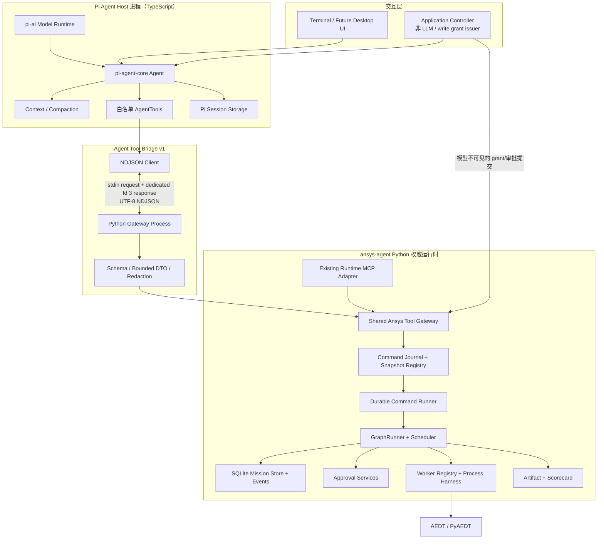
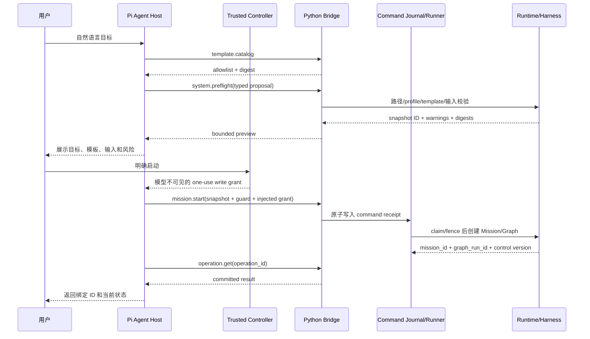
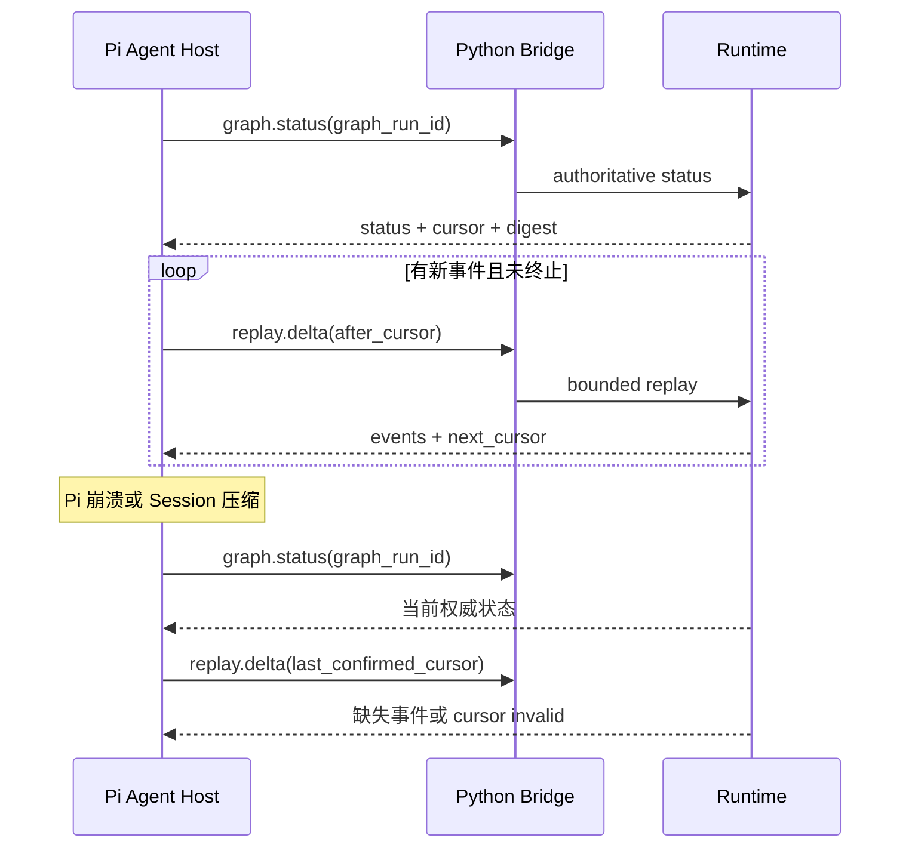
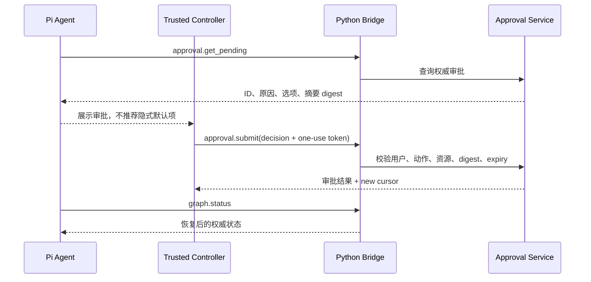

# Pi SDK ansys-agent Agent Host 架构规格

## 1. 元数据

| 字段 | 值 |
|---|---|
| 状态 | Proposed；P4 写入阶段暂停，等待本规格第 20.6 节阻断门通过 |
| 日期 | 2026-07-26 |
| 目标版本 | Pi Agent Host / Operator Protocol v1 |
| Pi 基线 | `@earendil-works/pi-agent-core@0.82.1` + `@earendil-works/pi-ai@0.82.1` |
| Node 基线 | `>=22.19.0` |
| Python 基线 | 仓库声明的 `>=3.11` |
| 决策 | Pi 作为领域 Agent Host；Python Runtime/Harness 保持工程状态与效果权威 |
| 研究依据 | [研究与分析报告](./README.md) |
| 实施分解 | [详细实施计划](./implementation-plan.md) |

### 1.1 本轮审查结论

P0-P3 的只读契约、专用协议管道、最小 Pi Agent 与 Session 恢复方向可以保留，但它们只证明
“Pi 能安全观察”，尚未证明“Pi 能成为 ansys-agent 的主 Agent Host”。在开放任何 R2 写工具前，
必须先补齐：每个 operation 的响应 schema、服务端 command journal、authoritative control digest、
数据库 writer lease/fence、受信任 write grant、持久化 preflight snapshot、资源句柄和独立执行 owner。

本规格还明确纠正一个范围遗漏：现有 Claude Code 入口已经使用 Runtime MCP、Knowledge MCP、
`InteractiveKernel`、`AssistantWorkflowManager`、live manager 和 Harness。Pi Host 应复用它们下面的
共享 Python 应用服务，不得另造一套能力目录、审批语义或 Harness 调度实现。

## 2. 问题陈述

现有 ansys-agent 已经能以 YAML Graph 驱动分析、建模、评分、决策、审批、恢复和真实
AEDT 执行，但自然语言会话、provider 切换、流式工具交互和长对话上下文管理仍较薄。

Pi 用于取代 Claude Code 一类重型通用 Agent 的会话、ReAct、provider 与工具骨架，而不是
只做一个外层聊天窗口。它也有自己的 Agent Loop、Session 和工具模型；若把它错误地当成
GraphRunner 或 Harness 的替代品，会产生两个工程调度器、两个状态源、两种恢复语义和更大的
权限面。

本规格定义一个受约束的 Pi Agent Host：

- 用户与 Pi Agent Host 交互；
- Pi 通过版本化高层领域工具协议编排 ansys-agent；
- Python 继续决定什么可以执行、何时执行以及结果是否有效；
- Pi 消失时，Mission 仍然完整、可恢复、可审计。

### 2.1 角色边界

Pi 是唯一的**对话 Agent Loop**，负责决定何时查询、何时请求一个已授权的领域动作、如何向
用户解释结果。Python Graph 是唯一的**工程执行循环**，负责节点调度、worker/harness 调用、
审批、恢复和数值判定。两者不是竞争的控制器：Pi 只能发起类型化应用服务调用，不能直接执行
worker、PyAEDT、shell 或任意文件操作。

### 2.2 “替代 Claude Code”的范围

v1 替代的是 Claude Code 当前承担的会话、模型调用、ReAct 工具循环、流式反馈与上下文压缩，
不是复制它的通用编码能力。迁移按以下范围验收：

| 当前能力 | Pi Host v1 | 说明 |
|---|---|---|
| 受限对话、工具循环、流式输出、压缩 | 必须替代 | 由 `pi-agent-core + pi-ai` 提供 |
| Graph/Workflow 目录、预览、单步推进、状态恢复 | 必须替代 | 复用现有 Workflow/Harness 应用服务 |
| typed live/artifact Harness tools | 分批迁移 | 由服务器 capability manifest 选择，不手写第二份目录 |
| AskUserQuestion/用户确认 | 必须替代 | Host UI/Controller 能力，不注册成模型可伪造的写工具 |
| Knowledge MCP/API Memory | v1.1 可选 | 只读适配，不能阻塞首个 recorded 垂直切片 |
| Exploration/Promotion | v2 再评估 | 保留 Claude 路径，Pi v1 不宣称功能等价 |
| 任意 Bash、文件编辑、开放 Python | 不迁移 | 不属于领域 Agent Host 的目标权限面 |

在对应 parity gate 通过前，`ClaudeDesktopLauncher` 保持可用；Pi 采用并行 launcher 和 feature
flag，不能直接覆盖现有入口。

## 3. 目标

### 3.1 功能目标

1. 用户能用自然语言发起、查看和监控受支持的 ansys-agent Mission。
2. Pi 能在目录中选择合适的 YAML 模板，生成类型化初始参数，并在启动前展示预览。
3. Pi 能以流式方式说明当前阶段、等待原因、可恢复错误和下一步动作。
4. Pi 能恢复一个已有 `mission_id/graph_run_id`，而不依赖旧对话全文。
5. Pi 能使用多个受支持 provider，并记录 token、cost、latency 和 tool trace。
6. Pi 能在严格写保护下推进 Graph 或提交干预请求。
7. 人工审批可被 Pi 展示，但决定必须经过受信任的非 LLM 通道。

### 3.2 工程目标

1. 保持现有 Python/YAML/SQLite/AEDT 架构和测试行为。
2. 建立可独立测试、可版本化、与 UI/模型无关的 Operator API。
3. 所有跨边界数据有 schema、大小上限、错误分类和关联 ID。
4. 所有写操作可检测重复、过期状态和并发冲突。
5. Node sidecar 可被完全关闭，回退到现有 Python 入口。

## 4. 非目标

- 不用 TypeScript 重写 GraphRunner、Scheduler、MissionStore 或 worker。
- 不让 Pi 直接启动 PyAEDT、访问 Desktop API、控制 license 或查询 worker registry。
- 不让 LLM 直接判断 S 参数/TDR 数值 pass/fail。
- 不把 Pi Session 作为 Mission/Event/Approval 的权威存储。
- 不在 v1 中替换 YAML Graph 内部的 `kind: agent` 或 `llm.py`。
- 不在 v1 中提供任意 shell、任意文件读写、任意 SQL 或任意模板执行。
- 不依赖未正式发布的 Pi orchestrator 或未文档化的 `AgentHarness`。
- 不承诺远程多用户服务；v1 面向单机 Windows/AEDT 工作站。

## 5. 不变量

以下条件在所有实现阶段都必须成立：

1. **单一状态源**：Mission/GraphRun/Approval/Event/Artifact 的权威状态只在 Python/SQLite。
2. **单一工程裁决**：几何验证、数值评分、pass/fail 和停止条件由确定性程序或现有图节点决定。
3. **写前校验**：模型给出的参数永远被视为不可信输入，由 Python 完整复验。
4. **显式副作用**：写工具和只读工具分离；写工具串行、幂等、带状态前置条件。
5. **审批隔离**：approval token、HMAC secret 和提交能力不进入 LLM 上下文。
6. **数据最小化**：raw 曲线、完整工程文件、凭据和超大 node payload 不进入模型。
7. **中止不混淆**：停止 Pi turn、停止 tool wait、停止 Mission 是三种不同动作。
8. **可拔除**：移除 `integrations/pi-operator` 后，Python Runtime 仍能运行现有任务。
9. **版本可重现**：Pi/Node/Python/Schema 版本在 trace 中可定位，依赖精确锁定。
10. **失败关闭**：schema 不匹配、未知工具、过期 cursor、未知审批或权限不明时拒绝执行。

## 6. 总体架构



### 6.1 进程模型

v1 区分三个生命周期角色：

1. `pi-agent-host`：Node/TypeScript 交互进程，持有模型连接、Agent Loop 和 Pi Session。
2. `python -m aedt_agent.operator_bridge`：本机 gateway 子进程，只校验、查询或持久化 command；
   stdin 只接收 request NDJSON，专用匿名响应管道（首选子进程 fd 3）只发送 response/event。
3. Python command runner/supervisor：拥有 Graph/Harness/worker 的执行生命周期。R2 command 先写入
   journal，再由 runner claim；Node 或 gateway 退出不能成为外部副作用的 owner。

`observer` 可以只启动前两个角色并使用 SQLite read-only 连接。`controlled-recorded` 与
`live-approved` 必须具备第三个角色；在 runner 尚未实现前，只允许 fake/recorded 的显式测试
composition root，不能声称 Node 被终止后任务仍会继续。

选择本机匿名管道而不是 HTTP 的理由：

- 不新增端口、TLS、认证服务和防火墙配置；
- 子进程生命周期明确，适合本机 Windows/AEDT；
- 协议可录制为 fixture，方便故障注入；
- 协议与 stdout/stderr 使用不同 OS 管道，native 日志不能污染 framing；
- 将来需要远程服务时可在相同 operation/schema 上增加 transport adapter。

官方 `pi --mode rpc` 可作为快速 spike 或反向由 Python 驱动 Pi 的参考，但 v1 生产目标是
直接使用 `pi-agent-core + pi-ai` 构建最小领域 Agent Host，不引入 coding-agent 默认资源面。

## 7. 状态与职责所有权

| 能力/数据 | Pi Agent Host | Python Runtime | 说明 |
|---|---|---|---|
| 用户对话、thinking、streaming | 权威 | 不持有 | 可丢弃或压缩 |
| Pi Session Tree | 权威 | 仅记录 binding ID | 不是 Mission 日志 |
| provider/model/API 适配 | 权威 | v1 不变 | secrets 不进 transcript |
| 模板建议 | 建议 | 校验并决定是否可用 | 只能从 allowlist 选 |
| Mission/GraphRun | 观察 | **权威** | SQLite 持久化 |
| Graph 调度与 handoff | 无 | **权威** | Pi 不调用 node/worker |
| Approval | 展示摘要 | **权威** | 提交由 Application Controller |
| Event cursor/replay | 缓存最后观察值 | **权威** | 写前必须重读 |
| AEDT/process/license | 无 | **权威** | Pi 不接触 |
| Artifact/raw data | bounded metadata | **权威** | raw data artifact-only |
| Scorecard/pass-fail | 解释 | **权威** | 不允许 LLM 覆盖 |
| 审计 | Pi trace | Python event/audit | 用 correlation IDs 关联 |

## 8. 组件规格

### 8.1 Pi Agent Host

职责：

- 初始化固定版本的 `pi-agent-core` Agent 与 `pi-ai` model runtime；
- 加载项目专用 `SYSTEM.md` 和一个 ansys orchestration Skill；
- 仅注册本规格列出的 AgentTools；
- 订阅 Pi 事件，生成 UI 流和 telemetry；
- 在 tool 前后执行风险标记、脱敏、大小校验和 trace 关联；
- 保存可选的 Pi Session，并保存 Python binding metadata；
- 在重启/切换会话后执行 authoritative rehydrate。

Host profile 由进程启动配置决定，不能由模型或 prompt 切换：`observer` 只注册 R0/R1；
`controlled-recorded` 才能注册经过 Python guard 的 R2 recorded 工具；`live-approved` 需要
单独的受信任控制器与真实 AEDT 批准。任何未实现或未知 profile 都失败关闭。

默认安全限制：

```text
builtin tools                     = none
project extension auto-discovery  = disabled
project instruction auto-loading  = disabled
write tool execution              = sequential
max turns per user prompt         = 12
max write calls per prompt        = 3
max consecutive tool errors       = 2
max tool result JSON              = 64 KiB
target status/result size         = 8-16 KiB
```

限制必须可以通过更严格的配置收紧，但生产 profile 不允许放宽为任意工具。

### 8.2 Python Shared Ansys Tool Gateway

提取共享应用服务层，避免 TypeScript 绑定 CLI 私有工厂，也避免与当前 Runtime MCP 重复实现
能力目录、preview/apply、live target binding 和 Harness 路由：

```text
SharedAnsysToolGateway
  - handshake()
  - capability_manifest()
  - template_catalog()/describe_template()
  - preflight()
  - start_mission()
  - get_graph_status()
  - get_replay_delta()
  - visualize_graph()
  - query_artifact_bounded()
  - get_pending_approvals()
  - prepare_approval_decision()
  - advance_graph()
  - apply_intervention()
  - stop_graph()
  - get_operation()
```

Gateway 复用或下沉当前 `InteractiveKernel`、`AssistantWorkflowManager`、
`capability_catalog_v2`、`LiveAedtSessionManager`、`AnsysAgentSupervisor`、GraphRunner、Replay、
Intervention 和 Approval Service。现有 FastMCP server 与 Pi Bridge 都只是它的 transport adapter；
两条入口必须共享同一个服务器 capability manifest、profile guard 和 preview/apply 语义。Gateway
返回专用 DTO，不直接暴露内部 ORM/dataclass/dict。

`OperatorService` 可在迁移期保留为只读 facade，但不得成为第二套写服务。P4 写操作必须先证明
调用的是共享 Gateway/command journal，而不是从 Bridge 直接调用 GraphRunner。

### 8.3 Bridge Process

Bridge/Gateway process 只做：

- `observer` 构建只读 Runtime；controlled/live 只构建 Gateway、schema catalog 和可写 command store，
  不注册 worker；
- 校验 envelope 和 operation arguments；
- 调用共享 Tool Gateway；
- 对 R2 只持久化 command 并返回 receipt，不拥有长时间 Harness/AEDT 副作用；
- 把内部异常映射为稳定错误；
- 对输出做 schema、大小和秘密扫描；
- 将协议消息写到专用响应管道，将 stdout/stderr 作为诊断通道；
- 在 EOF/parent exit 时优雅关闭本地资源，但不隐式取消 Mission。

Bridge 不做 Agent 推理，不拼 prompt，不实现第二套调度。Node 启动 Bridge 时显式构造环境
allowlist，provider API key、Host session secret 和 write-grant signing secret 不得被 Bridge、
Harness、worker 或 AEDT 子进程继承。

### 8.4 Command Journal 与执行 Runner

所有 R2 写入先形成持久化 `CommandRecord`，最少包含：

```text
operation_id, operation, idempotency_scope, idempotency_key
canonical_request_digest, target_resource, profile_id
authorization_grant_digest, preflight_snapshot_id
state, fencing_token, claimed_by, attempt
created_at, claimed_at, completed_at
result_resource, result_data, safe_error
```

状态机固定为 `prepared -> claimed -> running -> committed | failed | unknown`。claim、fence 校验和
状态迁移必须在事务内完成；外部副作用开始后不能靠删除记录回滚。`operation.get` 是
`outcome_unknown`、timeout 和 Session 恢复的唯一对账入口。Runner 的恢复策略按 capability 声明为
`resume`、`reconcile` 或 `manual_review`，禁止一律重放。

### 8.5 Snapshot、资源与授权

- preflight snapshot 是服务端持久记录或由服务端密钥签名的不可伪造对象；v1 选择**持久记录**，
  绑定完整 canonical input、template/capability manifest digest、profile、资源 digest、caller 和 expiry。
- `mission.start` 的 snapshot 单次消费；同一 idempotency key 可返回原结果，不同 key 再消费失败。
- layout、artifact、workspace 等路径由 Trusted Controller 注册为 opaque resource handle。模型只看到
  handle、类型、显示名、大小/digest 等 bounded metadata，Python 在执行时重新解析并检查 allowed root。
- R2 需要短期、一次性、action/resource/snapshot/digest 绑定的 write grant。Controller 将 grant 保存在
  模型不可见的 Host state；AgentTool dispatch 时由 Host 注入，模型参数和 Session transcript 均不包含 token。
- Host 在发送 R2 前先把 request ID、idempotency key、canonical payload digest 和状态写入本地 outbox；
  完成/对账后再终结，避免 Node 在发送后、保存 Session 前崩溃而丢失 key。

## 9. Operator Protocol v1

### 9.1 传输规则

- 编码：UTF-8，无 BOM。
- framing：每行一个完整 JSON object，以 LF 结束。
- stdin：只允许 request；专用响应管道只允许 response/event。
- stdout/stderr：只允许诊断日志，TypeScript 不在这两个通道上解析协议。
- 响应管道首选子进程 fd 3，Bridge 启动后立即标记为不可被 AEDT、worker 或孙进程继承。
- 单行协议硬上限：1 MiB；Agent tool `data` 编码后硬上限：64 KiB。
- 每个 request 必须恰好收到一个 terminal response。
- 可在 terminal response 前发送零到多个 progress event。
- v1 对 envelope、arguments、result 和 event 全部拒绝未知字段；可选扩展只能放入显式
  `extensions` 对象。需要新增字段时先更新 schema minor、双端和 compatibility corpus，不能依赖忽略字段。
- `schema_version` 使用 `"1.0"`；破坏性变更升级 major。
- 时间使用 UTC RFC 3339；ID 使用 UUID 或现有仓库不可变 ID，不从文本推断。

专用响应管道上的空行、非 JSON、非法 UTF-8、超长帧、未知 major、schema 错误、截断帧或
未知 request ID 一律视为 `protocol_error`。Bridge 必须关闭通道并使所有 pending request
失败，不能忽略杂行继续解析。只读操作可在重启后有界重试；写操作必须先调用
`operation.get`，使用原 `operation_id/idempotency_key` 对账，禁止生成新 key 盲目重发。

在导入 Runtime、PyAEDT 或其他 native 模块前，Bridge 还应执行纵深防御：

- 禁用 PyAEDT screen logging，并把 Python logging 定向 stderr；
- flush 后把 CRT fd 1 重定向到 fd 2；
- Windows 同步更新 `STD_OUTPUT_HANDLE` 指向 `STD_ERROR_HANDLE`；
- 不把这些重定向当作协议隔离的唯一保证，专用响应管道才是主边界。

### 9.2 请求 envelope

```json
{
  "schema_version": "1.0",
  "type": "request",
  "request_id": "018f...",
  "trace_id": "018f...",
  "operation": "graph.status",
  "sent_at": "2026-07-26T08:00:00Z",
  "caller": {
    "pi_session_id": "session-id",
    "pi_tool_call_id": "tool-call-id"
  },
  "arguments": {
    "graph_run_id": "graph-id"
  }
}
```

### 9.3 成功响应

```json
{
  "schema_version": "1.0",
  "type": "response",
  "request_id": "018f...",
  "trace_id": "018f...",
  "operation": "graph.status",
  "ok": true,
  "completed_at": "2026-07-26T08:00:01Z",
  "resource": {
    "mission_id": "mission-id",
    "graph_run_id": "graph-id",
    "event_cursor": "opaque-cursor",
    "state_digest": "sha256:..."
  },
  "data": {
    "status": "running",
    "summary": "..."
  },
  "error": null
}
```

### 9.4 错误响应

```json
{
  "schema_version": "1.0",
  "type": "response",
  "request_id": "018f...",
  "trace_id": "018f...",
  "operation": "graph.advance",
  "ok": false,
  "completed_at": "2026-07-26T08:00:01Z",
  "resource": {
    "mission_id": "mission-id",
    "graph_run_id": "graph-id",
    "event_cursor": "current-opaque-cursor",
    "state_digest": "sha256:..."
  },
  "data": null,
  "error": {
    "code": "stale_state",
    "message": "状态已变化，请重新读取后再决定。",
    "retryable": false,
    "details": {
      "required_action": "graph.status"
    }
  }
}
```

错误消息面向用户且不含 traceback、绝对 secret path、SQL 或原始 provider body。

### 9.5 progress event

```json
{
  "schema_version": "1.0",
  "type": "event",
  "request_id": "018f...",
  "trace_id": "018f...",
  "operation": "graph.advance",
  "event": "progress",
  "sequence": 1,
  "occurred_at": "2026-07-26T08:00:00Z",
  "data": {
    "phase": "waiting_worker_wave",
    "message": "正在等待当前 worker wave 完成。"
  }
}
```

v1 允许先只实现 request/terminal response。持续观察优先使用 `replay.delta` + cursor，
避免把 SQLite 事件日志伪装成一个可靠消息队列。

### 9.6 写保护

每个写 operation 的 arguments 必须包含：

```json
{
  "write_guard": {
    "idempotency_key": "client-generated-stable-key",
    "expected_control_version": "42-or-none",
    "expected_control_digest": "sha256:...",
    "reason": "用户可读的操作理由"
  }
}
```

规则：

- `idempotency_key` 在 server-defined scope 内唯一。已有资源使用
  `operation + resource_id`；`mission.start` 使用 `operation + caller_id + preflight_snapshot_id`；
- 相同 key/相同参数返回第一次的结果；
- 相同 key/不同参数返回 `idempotency_conflict`；
- control version/digest 不匹配返回 `stale_state`，禁止自动重试；event cursor 只用于 replay，
  不作为写并发令牌；
- `mission.start` 没有 graph control version，必须使用 preflight 返回的 snapshot ID、template/input/
  resource/profile digest，并使用 `"expected_control_version": "none"`；
- TypeScript 的顺序执行只是优化，Python 必须独立执行全部保护；
- 一个 prompt 内不得把状态读取与多个相互依赖的写操作并行发送。

`state_digest` 不是展示 DTO 的 hash。Python 必须从未截断的 canonical control projection 计算
`control_version/control_digest`，覆盖 GraphRun status/step、node/handoff、pending approval、绑定 job、
active lease/fence 和会影响下一步调度的字段。事务内按 `BEGIN IMMEDIATE` 或等价 CAS 重新读取、
比较并写入。模型可见的 bounded status 另有 `view_digest`，两者不得混用。

### 9.7 Schema 真相源与类型同步

`schemas/operator/v1/**/*.schema.json` 是跨语言 wire contract 的唯一真相源：

- 使用 JSON Schema Draft 2020-12、稳定 `$id` 和仓库内本地 `$ref`，禁止 remote ref；
- handshake 和 trace 记录 `schema_version` 与规范化 schema bundle digest；
- 每个 operation 同时定义 request、success result 和 progress event schema；envelope 的 `data`
  必须按 `operation` 关联到对应 result，不能继续是无约束 `{}`；
- TypeScript 静态类型从 schema 自动生成到只读 `src/generated/operator-v1.ts`，生成物
  提交仓库、标记 generated、禁止手改；
- Python v1 不生成 Pydantic 模型，继续使用符合仓库习惯的手写 bounded DTO；
- TypeScript 的 tool parameters、Bridge client operation 映射和 Python dispatcher 都从同一 registry
  消费生成/编译后的 schema；禁止再手写一份漂移的 TypeBox 参数定义；
- TypeScript 与 Python 在收发边界都必须针对同一 canonical schema 做运行时校验；
- replay cursor、control version/digest、idempotency、审批归属、路径、权限和 UTF-8 byte size 继续由 Python
  手写语义校验，代码生成不能替代这些控制；
- 协议 golden fixtures 由 schema 目录拥有并人工评审，双端只消费同一组 valid/invalid/wire
  fixtures，不能由两端互相生成 fixture 后循环自证；
- CI 重新生成 TypeScript 类型后执行 drift check，并比较双端 accept/reject 矩阵。

自动生成只解决字段名和静态结构漂移，不保证 regex/format、unknown fields、framing、大小、
写幂等或审批安全。运行时 schema、语义校验和 golden fixtures 三层都必须保留。

Python 在 response 写入前执行 result schema、64 KiB tool-result byte limit 和 secret/raw-data scanner；
TypeScript 只可进一步收紧，不能靠截断展示文本掩盖完整 `details`。错误响应必须转成 Pi 的
`isError` tool result，不能作为成功结果继续推理。

## 10. Tool Catalog v1

### 10.1 风险等级

| 等级 | 含义 | Pi 行为 |
|---|---|---|
| R0 | 本地静态只读 | 可自动调用 |
| R1 | 运行状态/有界 artifact 只读 | 可自动调用，记录审计 |
| R2 | 可恢复的 Runtime 写入 | 必须串行、guard、显式说明 |
| R3 | 取消、审批、真实 AEDT 关键动作 | LLM 只能准备，受信任 Controller 提交 |

### 10.2 AgentTool 列表

| Operation | 风险 | 关键输入 | 有界输出 |
|---|---:|---|---|
| `system.handshake` | R0 | client/schema/package versions | server capabilities、limits、versions |
| `template.catalog` | R0 | optional capability filter | server-owned manifest 中的 descriptors/digests/schema IDs |
| `template.describe` | R0 | template_id | typed required inputs、units、risk、worker/resource classes |
| `system.preflight` | R1 | template、profile、input metadata | readiness、warnings、snapshot ID/digests |
| `graph.status` | R1 | graph_run_id | status、active/waiting/failed summary、cursor |
| `replay.delta` | R1 | graph_run_id、after_cursor、limit | ordered bounded events、next cursor |
| `graph.visualize` | R1 | graph_run_id、format | bounded text/DAG metadata |
| `artifact.query_bounded` | R1 | mission_id、query、limit | metadata/aggregates/references, no raw curve |
| `approval.get_pending` | R1 | mission_id/graph_run_id | IDs、reason、options、digest、expiry |
| `approval.prepare_decision` | R1 | approval_id、decision intent | trusted UI request，不含 token |
| `operation.get` | R1 | operation_id 或原 idempotency scope/key | durable command state、原结果或 recovery action |
| `mission.start` | R2 | preflight snapshot、typed payload、guard | mission_id、graph_run_id、initial cursor |
| `graph.advance` | R2 | graph_run_id、guard | new status/cursor、bounded wave summary |
| `intervention.apply` | R2 | typed intervention、target、guard | result、新 cursor |
| `graph.stop.prepare` | R2 | graph_run_id、reason、guard | R3 confirmation request |

不注册为 AgentTool：

- `approval.submit`；
- `graph.stop.commit`；
- live process kill；
- execution profile 修改；
- secret/provider credential 管理。

它们只能由 Application Controller 在用户显式操作后调用 Python 受信任接口。

### 10.3 工具执行策略

- 所有 R2 工具设置 `executionMode: "sequential"`。
- R0/R1 只读工具只有在参数彼此独立时才允许并行。
- `beforeToolCall` 检查工具 allowlist、session write budget、已知 resource binding。
- 实际工具集是本地注册表与 Python handshake `capability_manifest` 的交集；profile 名称或 prompt
  不能扩大服务端能力。
- Python 仍做完整 schema、权限、control version/digest、profile 和 path 校验。
- `afterToolCall` 做 secrets/redaction、结果大小、错误字段和 raw artifact 检查。
- hook 修改后的参数必须重新执行 schema 校验；不能依赖扩展自动复验。

## 11. 核心流程

### 11.1 新 Mission



`mission.start` 不接受自由文本 layout 路径或隐式猜测；所有关键参数必须在 preflight 的 typed
proposal 中出现，文件类输入必须是 Controller 签发的 resource handle。preflight snapshot 过期、
已消费、manifest/profile/resource digest 改变时必须重新执行。

### 11.2 观察与恢复



`after_cursor` 必须带明确 scope 并且不得大于服务端 high-water mark；否则返回
`invalid_cursor`。若 cursor 已超出保留窗口，返回 `cursor_expired`，Pi 丢弃局部推断并用完整
bounded status 重新建立上下文。Protocol v1 在冻结前把这两个 code 加入 schema；若 v1 选择十进制
mission-event cursor，就不得同时称其为 opaque。

### 11.3 审批



模型可以解释选项和影响，但不能生成、查看或重放一次性 approval token。

### 11.4 失败与干预

1. Pi 读取 `graph.status` 和 `replay.delta`。
2. Python 返回结构化 `failure_class`、`recoverable`、`allowed_interventions`。
3. Pi 只能从 `allowed_interventions` 选择并向用户解释。
4. 写前再次读取 control version/digest，并由 Controller 签发绑定目标的 grant。
5. `intervention.apply` 先写 command journal，再由 Python 检查目标、状态、次数、fence 和幂等键。
6. `stale_state` 时停止当前方案，重新观察，禁止静默重试。
7. 同一失败重复两次没有新证据时停止自动干预并升级给用户。

## 12. Session 与上下文

### 12.1 Session binding

Pi Session metadata 只保存：

```json
{
  "schema_version": "1",
  "mission_id": "mission-id",
  "graph_run_id": "graph-id",
  "last_confirmed_event_cursor": "opaque",
  "last_state_digest": "sha256:...",
  "observed_at": "2026-07-26T08:00:00Z"
}
```

metadata 是导航提示，不是权威状态。恢复时总是先 handshake，再 `graph.status`。

v1 每个 Pi Session 只允许一个 active Graph binding；切换由 Host UI 显式完成，模型不能静默改写。
历史 binding 可保留为只读导航记录。写 outbox 独立于自然语言 Session/compaction，必须在 dispatch
前落盘并在恢复时先 `operation.get` 对账。

### 12.2 进入 LLM 的内容

允许：

- 用户目标和已确认约束；
- 模板名称、版本、digest 和简短说明；
- bounded status、失败分类、审批摘要；
- scorecard 的程序化结论、单位、阈值和 artifact reference；
- 最近少量相关事件；
- 操作结果和明确错误码。

禁止：

- API key、环境变量值、approval token；
- raw S 参数/TDR 数组；
- 完整 EDB/AEDB 工程内容；
- 无界 node payload/handoff；
- Python traceback、SQL、系统绝对 secret path；
- 未经脱敏的 shell/stdout/stderr。

### 12.3 压缩模板

压缩摘要必须分段保存：

1. 用户目标与不可变约束；
2. 已绑定的 Mission/GraphRun ID；
3. 最后观察状态、cursor、digest 和 `observed_at`；
4. 已执行操作及幂等键摘要；
5. 未决审批/风险；
6. 下一步只读观察动作；
7. “本摘要非权威，恢复时重新查询”的固定声明。

不在摘要中保存 raw artifact 或 approval token。关键 ID 必须作为结构化 metadata 另存，
不能只存在自然语言摘要中。

### 12.4 系统指令与 Skill

`SYSTEM.md` 只定义：

- Operator 角色与状态所有权；
- 只能使用已注册工具；
- 写前观察、不能猜 ID、不能绕过审批；
- scorecard 和单位忠实表达；
- 失败/停止/升级规则；
- 不宣称 Pi 具有沙箱。

Skill 提供模板选择与标准操作流程，但不包含 secret、任意命令或可执行代码。生产 Operator
不自动扫描仓库中的 `AGENTS.md`、extensions 或第三方 Pi packages。

## 13. 错误模型

| code | 含义 | retryable | Pi 行为 |
|---|---|---:|---|
| `invalid_argument` | schema/值/单位/路径无效 | false | 修正 proposal 或询问用户 |
| `not_found` | resource 不存在 | false | 停止猜测 ID |
| `invalid_cursor` | cursor 超过 high-water mark、scope 错误或格式错误 | false | 丢弃局部 cursor 并读取 status |
| `cursor_expired` | cursor 已离开保留窗口 | false | 完整 bounded rehydrate |
| `unsupported_operation` | operation/version 不支持 | false | 协议失败并升级 |
| `protocol_error` | framing/schema/response 违规 | false | 断开并重启 bridge，保留 Mission |
| `outcome_unknown` | 写操作可能已落库但响应通道损坏 | false | 用原幂等键和权威状态对账，禁止盲重试 |
| `unsafe_profile` | execution profile 不允许 | false | 只展示，不降级安全 |
| `approval_required` | 需要受信任审批 | false | 展示并等待 Controller |
| `stale_state` | control version/digest 已变化 | false | 重新读取，不重放写操作 |
| `idempotency_conflict` | key 与参数不一致 | false | 停止并报告 |
| `busy` | 资源/graph 正被操作 | true，仅只读等待 | 退避后读取状态 |
| `timeout` | 只读等待超时 | true，仅只读 | 有界重试 |
| `transient` | 临时只读失败 | true | 有界退避，最多 2 次 |
| `terminal_failed` | Graph/Node 已不可恢复失败 | false | 报告证据与允许干预 |
| `internal` | 未分类服务端错误 | false | trace ID + 安全摘要，升级 |

写请求超时、abort 或断链统一进入 `outcome_unknown`，不得生成新幂等键重试。必须先用
`operation.get` 查询原 receipt；仅重读资源状态不足以证明某次外部副作用是否发生。

协议 writer 必须是单一所有者，并把每个 NDJSON frame 串行、完整地写入响应管道。多个线程
不得分段写同一 JSON。bridge 断链时，在途只读请求标记失败；在途写请求统一标记为
`outcome_unknown`，即使模型认为工具尚未完成也不能自动重发。

## 14. 并发与一致性

当前 Graph advance 没有完整 graph-level lease，一次 wave 的多个持久化步骤也不是单一大事务。
因此这不是可以推迟到多用户阶段的问题。任何 R2 开放前必须完成：

- command journal 以数据库 lease + 单调 fencing token 对 graph/resource 做 claim；
- CLI、Supervisor、MCP 和 Pi Gateway 的同类写入口共享同一 lease/CAS 协议，或在迁移期明确拒绝
  绕过 Gateway 的写命令；
- Bridge 内 mutex 仅用于减少竞争，不能作为正确性边界；
- Python 每次写操作在事务内检查 expected control version/digest 和 fence；
- Pi 的多个 Session 可以只读观察同一 Graph，但不能同时写；
- 不自动把 `busy` 转为新的写请求；
- runner 崩溃后只有持有更新 fence 的恢复者可继续；旧 runner 的迟到提交必须失败。

这项限制是正确性要求，不是性能优化。

## 15. 审批与信任边界

三类现有审批可以统一展示，但不能统一为直接改数据库：

1. YAML `human_gate` approval；
2. controlled action digest-bound approval；
3. live/desktop one-use token approval。

Operator DTO 统一输出展示字段：

```text
approval_id
approval_kind
mission_id
graph_run_id
action
resource
reason
options
summary
summary_digest
expires_at
```

提交仍路由到对应现有服务。生产 UI 必须把用户选择绑定到 approval ID、resource、action、
summary digest 和当前用户；默认按钮不能是 approve，过期/已处理审批必须失败关闭。

## 16. 安全模型

### 16.1 威胁与控制

| 威胁 | 主要控制 |
|---|---|
| Prompt injection 请求 shell/文件/worker | 没有此类 AgentTool；服务端 operation allowlist |
| 模型伪造 Mission/Approval ID | Python 查库、资源关系校验、禁止模糊匹配 |
| 路径逃逸 | canonical path、allowed roots、layout digest、服务端复验 |
| 重放写请求 | 幂等键、control version/digest、审计 |
| 并发推进 | command journal、数据库 lease/fence、事务内 control digest/CAS |
| approval token 泄漏 | token 仅 Controller/Python 可见，不进入 tool result |
| provider 泄漏工程数据 | bounded/redacted DTO、artifact-only、provider policy |
| 恶意 Pi extension/package | 禁止自动发现；依赖 allowlist、lockfile、离线包 |
| native/stdout 污染协议 | 专用响应管道、fd/Win32 stdout 纵深重定向、严格 framing、非法帧失败关闭 |
| secret 进入 Session | pre/post redaction、secret scanner、测试 canary |
| Node/Pi 供应链漂移 | 精确 pin、integrity lock、SBOM、离线 tarball、升级门 |

### 16.2 执行环境

Pi 没有内建沙箱。部署至少采用：

- 专用低权限 OS 账户或受控工作站账户；
- 最小环境变量注入；
- provider key 由 runtime secret source 获取，不写 Session；
- Node 创建 Bridge/Harness/worker 时使用显式环境 allowlist，不默认复制 `process.env`；
- 无运行时 npm install；
- 工作目录与 artifact root allowlist；
- 可配置网络 egress；
- Python execution profile 继续约束 AEDT 版本、timeout 和路径。

容器不是 v1 的硬要求，因为 AEDT/Windows 集成通常需要宿主能力；若未来远程运行，应使用
VM 或受控 Windows worker，而不是宣称普通 Node 进程构成隔离。

## 17. 可观测性

### 17.1 关联字段

所有 trace 至少携带：

- `pi_session_id`
- `pi_turn_id`（若 SDK 提供，否则由应用生成）
- `pi_tool_call_id`
- `request_id`
- `trace_id`
- `mission_id`
- `graph_run_id`
- `event_cursor`
- `idempotency_key`（仅写操作，日志中哈希化）

### 17.2 指标

- user-to-first-token latency；
- model latency、token、cost、provider/model；
- 每 Turn 工具数、错误数、写操作数；
- bridge request latency、restart count、protocol errors；
- stale state/idempotency conflict/busy 次数；
- status payload/result 截断次数与尺寸；
- Mission 完成率、恢复时间、approval wait 时间；
- Pi 与非 Pi 基线的总 wall time 和人工操作数。

Pi trace 记录“模型看到和调用了什么”，Python event/audit 记录“系统实际执行了什么”。
两者用 trace ID 关联，但不互相替代。

## 18. 配置

建议新增配置段：

```toml
[pi_agent_host]
enabled = false
host_profile = "observer" # observer | controlled-recorded | live-approved
protocol_version = "1.0"
node_command = "node"
bridge_command = ["python", "-m", "aedt_agent.operator_bridge"]
command_runner = ["python", "-m", "aedt_agent.agent_command_runner"]
session_persistence = true
session_root = ".aedt-agent/pi-sessions"
session_retention_days = 30
max_turns_per_prompt = 12
max_write_calls_per_prompt = 3
max_tool_result_bytes = 65536
max_turn_wall_seconds = 300
default_model = "..."
python_execution_profile = "safe-recorded"
capability_manifest = "config/pi-host/controlled-recorded.json"
mission_db = ".aedt-agent/assistant-workflows/missions.db"
host_state_db = ".aedt-agent/pi-host-state.db" # 仅 Session binding/outbox，非工程权威
allowed_resource_roots = []
provider_data_policy = "engineering-metadata-only"
```

Host profile 与 Python execution profile 是不同概念，必须同时进入 handshake、trace 和 Graph binding。
Python 从 capability manifest 导出不可变 `manifest_digest`；Pi 只注册本地 schema 与服务端 manifest
的交集。生产配置不允许在 prompt 中修改 allowlist、bridge command、execution profile、resource
roots 或 secret source。`enabled=false` 是默认和回滚开关。

Session、trace 和 diagnostic log 都可能包含专有工程语义，即使没有 raw curve 也不是公开数据。
部署必须定义 ACL、保留期、删除、日志轮换和可选静态加密；provider policy 必须说明哪些数据允许外发。

Command journal、preflight snapshot、operation receipt、control version 与 writer lease/fence 使用 Mission
SQLite 的 expand-only 表，以便在同一事务内校验 graph state 和 fence。`host_state_db` 只保存 Node
outbox/Session 导航，不能参与工程真相或替代 command journal。

## 19. 版本与升级

### 19.1 固定策略

- Pi 包精确固定 `0.82.1`，提交 lockfile。
- Node 锁定到已验证的 22.x patch 或企业分发版本。
- Protocol v1 canonical schema 存在仓库中，只生成 TypeScript 静态类型；Python 使用手写
  bounded DTO，并与 TypeScript 对同一 schema 做运行时校验。
- handshake 返回 client/server/package/schema 版本、schema bundle digest 和 feature flags。
- Pi 升级不能与 Python contract 变更、provider 切换或真实 AEDT rollout 同批进行。

### 19.2 升级门

每次 Pi 升级必须通过：

- compile/typecheck/lint；
- schema meta-validation、禁止 remote ref、生成类型 drift check；
- fake provider Agent Loop；
- tool schema 和 hook 行为；
- parallel/sequential ordering；
- session create/resume/compact；
- abort 与最终 settled 语义；
- NDJSON contract/golden fixtures；
- bridge crash/restart；
- 全部 recorded A/B fixtures；
- 安全 canary 和未知工具拒绝。

## 20. 验收标准

### 20.1 架构验收

- 删除 Node integration 后 Python 测试仍通过。
- Pi 包不出现在 Python 核心依赖中。
- Python core 不反向依赖 TypeScript 文件或 Pi Session。
- Agent 只看到 v1 allowlisted tools。
- Graph/AEDT/scorecard 状态所有权测试通过。

### 20.2 协议验收

- 每个 operation 的 request/success result/error/progress fixture 双端一致；`data` 无未约束对象。
- 专用响应管道只含合法协议帧；stdout/stderr 的 native 日志不会进入协议解析。
- 响应管道出现杂行、非法 UTF-8、超限或 schema 错误时失败关闭，不静默跳过。
- 超大、未知、缺字段、乱序和非法 UTF-8 输入失败关闭。
- 相同幂等键返回同一结果；冲突参数被拒绝。
- stale control version/digest 写入 100% 被拒绝。
- write timeout 后不会产生第二次副作用。
- 错误 response 在 Pi 中标记为 tool error；完整未脱敏 `details` 不进入模型或 Session。
- `pi_session_id/turn_id/tool_call_id/request_id/trace_id` 可贯通到 Python audit。

### 20.3 安全验收

- prompt injection 无法获得 shell、文件、worker、SQL 或 approval submit。
- canary secret、approval token、raw curve 不进入 provider request 和 Session。
- 未信任扩展、skills、AGENTS 和 npm package 不被自动加载。
- 所有 R2/R3 操作有 audit event 和完整关联 ID。

### 20.4 运行验收

- 10 个 recorded Mission 与基线结果一致。
- 3 个 timeout/recovery 场景无重复副作用。
- 3 个 approval wait/resume 场景保持 ID 和摘要 digest。
- Pi 进程被强制终止后，Python Graph 保持可恢复。
- opt-in 的 1 个真实 AEDT Mission 生成完整 evidence package 并正确清理进程/license。

### 20.5 `P3-READONLY-GATE`

首 10 个工作日和 P3 验收前是不可绕过的硬只读门：

- 只允许版本化异质 recorded fixture 与全部 R0/R1 operation；样本覆盖 running/succeeded/failed/
  waiting_approval、replay、artifact、截断和错误路径，不能用十个未推进的空 Graph 代替；
- handshake 不宣告 R2/R3 capability；
- Pi 不注册 R2/R3 tools；
- Python dispatcher 即使收到手工构造的 R2/R3 request 也必须拒绝；
- 只读 profile 不运行 schema migration、自动建表、worker 或 AEDT；
- 优先使用 SQLite read-only URI 或不可变 fixture 副本；
- demo 前后比较数据库文件哈希和 event/attempt/artifact 数量、worker/AEDT 进程数，并保存 provider
  request canary、Session rehydrate、R2/R3 dispatcher 拒绝和 expected-fact 解释证据。

只有本节和 P3 的安全、恢复、上下文验收全部通过，才可用独立配置和评审开启 P4。

### 20.6 `P4-WRITE-FOUNDATION-GATE`

P3 通过后仍不得直接实现或注册 `mission.start/graph.advance`。以下阻断项全部完成后才进入 P4
垂直切片：

1. 全 operation response schema、Python 发送前验证、TypeScript 接收后验证通过。
2. authoritative control projection/version/digest 与 bounded view digest 分离，并有截断节点、handoff、
   approval、lease 变化测试。
3. command journal、`operation.get`、Host outbox、数据库 lease/fence 和全部 kill-point 恢复测试通过。
4. controlled Bridge 只提交 command，durable runner 拥有 Harness；Node/Bridge kill 的预期行为有证据。
5. persistent preflight snapshot、opaque resource handle、one-use write grant 和环境变量 allowlist 生效。
6. `controlled-recorded` capability manifest 对模板中的每个 node/capability/resource class 做闭包验证；
   `requires_real_aedt`、live handler 和 `adapter_mode=real_build` 等逃逸路径全部拒绝。
7. 两个 Pi Bridge 加一个现有 CLI/MCP 写入口的并发战役证明旧 fence 的提交失败。
8. Harness job lease 在长任务中续租；健康 attempt 可被恢复者 adopt，stale/旧 fence attempt 不能新增
   artifact/event/checkpoint；Bridge/worker/AEDT child 与 grandchild 不继承 fd 3 或 Host secret handle。
9. approval 权威记录绑定 graph/action/resource/digest/expiry 并使用 pending CAS；同一 Mission 多 Graph
   的审批不会串线。

该门失败时可以继续完善 Agent Host 的只读 UI/provider/session，但不得以 prompt 限制替代服务端控制。

## 21. 发布与回滚

发布顺序：

1. Operator API + fixtures，尚无 Pi。
2. Pi 只读影子模式。
3. 内部用户显式启用 R2 工具。
4. `PiDesktopLauncher` 与 `ClaudeDesktopLauncher` 并行的单工作站 beta。
5. Graph/Harness parity gate 通过后，才可称为日常 Graph 流程的 Claude Host 替代。
6. live/Knowledge/Exploration 各自通过独立 gate 后再扩大替代范围。

回滚：

- 设置 `pi_agent_host.enabled=false`；
- 停止 Node/bridge，不取消 Mission；
- 用现有 CLI/`ansys-agent` 通过 `graph_run_id` 继续；
- 保留 Pi trace 供诊断；
- 如协议不兼容，服务端拒绝 handshake，不做隐式降级。

## 22. 已决策事项

| 问题 | 决策 |
|---|---|
| 重写还是适配 | 适配，不重写 |
| Pi 产品层还是 Core | 生产 PoC 用 `pi-agent-core + pi-ai` |
| 传输 | stdin 请求 + 专用 fd 3 响应管道的本机 NDJSON v1 |
| 状态权威 | Python/SQLite |
| Python 能力层 | Pi Bridge 与现有 MCP 复用 Shared Ansys Tool Gateway |
| 默认工具 | 无内置工具，仅领域 allowlist |
| 写执行 owner | Bridge 只提交 durable command；Python runner/Harness 执行 |
| 写并发 | command journal + control digest + DB lease/fence；Pi 本地顺序仅为 UX |
| 审批 | LLM 展示，trusted controller 提交 |
| 文件/工程资源 | Controller 签发 opaque handle，模型不传绝对路径 |
| raw 工程数据 | artifact-only |
| 图内 agent | v1 不迁移 |
| Pi 版本 | 精确固定 `0.82.1` |
| 最终采用 | 由 A/B gate 决定 |

## 23. 后续独立决策

以下项目不阻塞 v1，但必须分别立 ADR：

- 是否让桌面 UI 成为 approval trusted controller；
- 是否在企业离线环境允许外部 provider；
- 是否在 v2 用 `pi-ai` 替换 `llm.py` 的 provider port；
- 是否对 Pi Session 做企业保留、加密和删除策略；
- 是否增加远程 transport；若增加，认证与租户隔离必须独立设计。

以下项目已经是 v1 写入阻断项，不再列为“以后再决定”：command/control 数据库布局与 expand-only
migration、graph command lease/fence、durable runner、write grant issuer 和 preflight snapshot registry。
