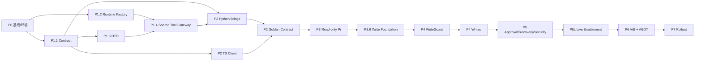

# Pi SDK ansys-agent Agent Host 详细实施计划

> **计划重述（2026-07-26）**：目标是让 Pi 充当 ansys-agent 的轻量领域 Agent Host，
> 替代 Claude Code 式的通用 Agent 骨架；不是将 Pi 限定为长期只读旁路。现有 P0-P3 产物
> 保留为 Host 的安全地基。下一最小垂直切片是 `controlled-recorded`：Pi 发起
> `template.catalog -> preflight -> mission.start -> operation.get -> graph.advance(一次) ->
> operation.get/status -> 重启恢复`，
> Python Graph/Harness 保持唯一工程执行权威，且强制禁止真实 AEDT。

> **审查门（2026-07-26）**：P4 暂停。当前只读切片可继续完善，但 response contract、
> command journal、control digest、DB lease/fence、durable runner、write grant、resource handle、
> snapshot registry 和 Harness 恢复未完成前，不得注册 R2。详见 P3.6。

## 1. 计划信息

- 日期：2026-07-26
- 对应规格：[Pi SDK ansys-agent Agent Host 架构规格](./architecture-spec.md)
- 研究报告：[基于 Pi Agent SDK 构建 ansys-agent](./README.md)
- 交付方式：分阶段、门控、默认关闭
- 重估投入：38-58 人日，另预留 20%-30% 故障与真实 Windows/AEDT 调试余量；真实
  AEDT/license、provider 费用和工作站排期单列
- 关键原则：Pi 先成为唯一对话 Agent Loop；Python 继续是唯一工程执行循环；先安全观察，
  再 controlled-recorded，再真实 AEDT

## 2. 成功定义

PoC 成功不是“Pi 能调用一次 CLI”，而是以下条件同时成立：

1. 现有 Python Runtime、YAML Graph、SQLite、审批和 AEDT 所有权不变。
2. Pi 能用固定 schema 安全地观察、启动和有限干预 Mission。
3. 重连、超时、重复请求、stale control state 和进程崩溃不会产生重复副作用。
4. approval token、raw artifact 和 secret 不进入模型上下文。
5. recorded 与真实 AEDT 测试均提供可复查证据。
6. 至少一个 provider/交互/成本/维护收益达到现有评估门。
7. `pi_agent_host.enabled=false` 可立即回到非 Pi 路径，升级后的 DB 仍可被旧 CLI/MCP 读取。
8. Graph/Harness 主流程通过与当前受限 Claude Host 的 parity gate，才能称为“替代 Claude Code”。

### 2.1 当前实现基线

| 区域 | 当前证据 | 审查判断 |
|---|---|---|
| Request/response schema/NDJSON/fd 3 | Python/TypeScript 定向测试已通过；九个只读 operation 的 response `data` 已按 operation 校验 | 只读 P1/P2 基线通过，写 operation 仍无 result contract |
| Pi Host | `main.ts` 仅提供固定 DeepSeek adapter：官方 HTTPS endpoint、`DEEPSEEK_API_KEY` 与 `deepseek-v4-flash`；流式命令行 observer、provider-profile digest 与最小 JSONL telemetry 均已接入 | 仅 R0/R1；不注册编码、文件、shell 或写入工具；禁止重定向、模型/endpoint override 与默认 provider 回退 |
| Session | JSONL binding、独占 lease、启动 rehydrate、settled commit 与崩溃回退已接入 Host；P3 gate 以独立 Node 进程验证 init/resume | 不保存写 outbox；该能力刻意留给 P3.6 |
| P3 gate | 版本化 manifest 固定 10 Mission/Graph ID、五模板、profile、inputs 与 inventory digest；真实 `AgentHarness -> fd 3 Bridge -> SQLite mode=ro` 覆盖九个 R0/R1 operation | 自动 gate 已闭合；真实 provider 工作站演练和离线安装证据仍是发布前置条件 |
| 写入 | schema 名称存在，服务/dispatcher 未开放 | 正确保持关闭 |
| Shared Harness gateway | 现有 MCP/Workflow 已成熟，新 facade 尚未复用 | 先提取共享应用层 |

### 2.2 已确认的实现缺口

| 证据 | 影响 | 纳入阶段 |
|---|---|---|
| Agent handshake tool 发送 `{}`，schema 强制 `client`；生成类型未驱动 tool/client | 已改为 Host 固定注入 `client`，并有回归测试 | 已关闭（P1） |
| response `data` 未按 operation 约束，Python 仅验 envelope | 已在同一 operation schema 的 `$defs.successData` 定义并由 Python/TS 双端验证 | 已关闭（只读 P1） |
| TS timeout 删除 pending，迟到 response 变 unknown ID；`ok=false` 仍按成功返回 | `ok=false` 已作为错误返回，超时后的只读迟到响应会验证后丢弃；写入的 outcome 对账仍待 P3.6 | P3.6 |
| Python 只宣告 64 KiB，TS 截断 text 但保留完整 `details` | 模型/Session 仍可能接收超限或敏感数据 | P1/P2 |
| tool call ID/caller 未进入 request，spawn 默认继承全部环境 | caller 现带 Pi session/tool-call ID，Bridge 仅继承运行 Python 所需环境 | 已关闭（P2/P3） |
| preflight 只 hash 输入 shape，future replay cursor 会被原样接受 | future cursor 已拒绝；snapshot 不绑定值仍是 P3.6 写前置条件 | P3.6 |
| `safe-recorded` 的进程内 BRD worker 仍可选择 `real_build` | controlled-recorded 可能触发真实 adapter | P3.6/P4 |
| Harness lease 可能短于 worker timeout，且缺可靠 renewal/adopt fence | 健康任务可能重排并留下重复 artifact/event | P3.6 |
| schema 从源码树顶层定位，wheel 未保证携带 | 离线安装后 Bridge 可能无法启动 | P1/P7 |

## 3. 里程碑

| 阶段 | 目标 | 预计投入 | 写权限 | 退出门 |
|---|---|---:|---:|---|
| P0 | 基线、Claude/MCP 迁移盘点、架构冻结 | 3-5 人日 | 无 | 基线与 parity 清单可重现 |
| P1 | 完整 Tool Contract 与共享 Python Gateway | 6-9 人日 | 测试内 | request/result/event schema、DTO/Gateway 单测通过 |
| P2 | Dedicated-pipe NDJSON Bridge | 4-6 人日 | 测试内 | fd 3 隔离、双端 fixture、重启、异常测试通过 |
| P3 | 可运行的 Pi Agent Host + 完整只读门 | 5-7 人日 | 无 | observer CLI/provider/UI、Session/outbox、异质 fixture 通过 |
| P3.6 | 写入基础硬门 | 6-9 人日 | 测试内 | journal/snapshot/grant/lease/runner/response schema 全通过 |
| P4 | `controlled-recorded` Host 垂直切片 | 5-8 人日 | R2（recorded） | `start -> operation.get -> advance(一次) -> 重启恢复` 可审计 |
| P5 | 审批、上下文与故障恢复 | 4-6 人日 | R2，R3 隔离 | 安全、恢复、approval ownership 测试通过 |
| P5L | `live-approved` 独立启用门 | 3-5 人日 + 排期 | R3 受控 | live manifest/controller/license preflight 通过 |
| P6 | 三路 A/B 与真实 AEDT 验证 | 3-5 人日 + 排期 | 受控 | 评估报告给出 adopt/defer/reject |
| P7 | 发布、离线包、运维 | 2-3 人日 | 按决定 | wheel/npm 离线安装、默认关闭、可回滚 |

各阶段严格顺序推进。P3 只读门通过后还必须通过 P3.6，才可进入 P4；P5L 未通过，不运行
Pi 发起的真实 AEDT。单纯观察由旧入口启动的真实 Mission 必须标记为 observer evidence，不能
计入 live execution gate。

## 4. 目标目录

### 4.1 共享契约

```text
schemas/operator/v1/
  envelope.schema.json
  bundle-manifest.json
  operations/
    system.handshake.schema.json
    template.catalog.schema.json
    system.preflight.schema.json
    mission.start.schema.json
    graph.status.schema.json
    replay.delta.schema.json
    graph.visualize.schema.json
    artifact.query_bounded.schema.json
    approval.get_pending.schema.json
    approval.prepare_decision.schema.json
    graph.advance.schema.json
    intervention.apply.schema.json
    graph.stop.prepare.schema.json
    operation.get.schema.json
    template.describe.schema.json
    # 每个已启用 operation：root 为 request；$defs.successData 为 success result；
    # 使用 $anchor: successData，供 Python/TS 用 <operation-id>#successData 校验。
  fixtures/
    valid/
    invalid/
    wire/
```

### 4.2 Python

```text
src/aedt_agent/operator_api/
  __init__.py
  contracts.py
  errors.py
  limits.py
  redaction.py
  runtime_factory.py
  service.py
  approvals.py
  tool_gateway.py
  capability_manifest.py
  control_projection.py
  command_service.py
  resource_handles.py

src/aedt_agent/operator_bridge/
  __init__.py
  __main__.py
  protocol.py
  dispatcher.py
  logging.py

src/aedt_agent/agent_command_runner/
  __init__.py
  __main__.py
  recovery.py
  runner.py
```

不要在 `src/aedt_agent/pi_agent/` 下实现。该包当前只是兼容别名，继续扩建会混淆
“Pi SDK integration”与旧命名。

### 4.3 TypeScript

```text
integrations/pi-operator/
  package.json
  package-lock.json
  tsconfig.json
  src/
    main.ts
    agent-host.ts
    config.ts
    contracts.ts
    model-runtime.ts
    session.ts
    context.ts
    telemetry.ts
    controller.ts
    outbox.ts
    generated/
      operator-v1.ts
    bridge/
      pipe-client.ts
      framing.ts
      errors.ts
    tools/
      readonly.ts
      writes.ts
      approvals.ts
      guards.ts
    resources/
      SYSTEM.md
      skills/
        ansys-orchestration/
          SKILL.md
  test/
    contract.test.ts
    bridge.test.ts
    tools.test.ts
    session.test.ts
    security.test.ts
      fixtures/
  scripts/
    generate-contracts.mjs
    check-contract-drift.mjs
```

### 4.4 测试与评估

```text
tests/operator_api/
  test_contracts.py
  test_service_readonly.py
  test_service_writes.py
  test_bounded_outputs.py
  test_redaction.py
  test_approvals.py
  test_concurrency.py

tests/operator_bridge/
  test_protocol.py
  test_dispatcher.py
  test_process_lifecycle.py
  test_golden_fixtures.py

benchmarks/pi_integration/
  cases/
  fault_scenarios/
  approval_scenarios/
  run_baseline.py
  run_pi_operator.py
  compare.py
  README.md

config/pi-host/
  observer.json
  controlled-recorded.json
  live-approved.json
```

## 5. P0：基线、环境与决策冻结

### P0.1 重建可重现开发环境

**变更**

- 根据 `pyproject.toml` 用受支持的 Python 3.11+ 重建 `.venv`。
- 验证本机 Node `>=22.19.0`；记录精确版本。
- 不在全局环境安装 Pi；所有 Node 依赖局部安装。
- 为离线场景记录 npm cache/tarball 获取方式，但运行时不得下载。

**验证**

```powershell
.venv\Scripts\python.exe --version
.venv\Scripts\python.exe -m pytest --collect-only -q
node --version
npm --version
```

**完成条件**

- `.venv\Scripts\python.exe` 不再指向已删除的解释器。
- 核心测试能收集和启动。
- Python、Node、npm 版本写入基线报告。

### P0.2 记录非 Pi 基线

**变更**

- 从现有 fixture 选定 10 个代表性 recorded Mission。
- 固定 template snapshot、seed、execution profile 和输入 digest。
- 记录完成率、wall time、人工步骤、恢复时间和结果 scorecard。
- 为 approval、timeout、intervention 各固定至少 3 个场景。

**建议文件**

- `benchmarks/pi_integration/cases/manifest.json`
- `benchmarks/pi_integration/baseline-2026-07.json`
- `benchmarks/pi_integration/README.md`

**完成条件**

- 任一开发者在无 Pi 情况下能重放基线。
- 结果包含 graph_run_id、fixture digest 和环境版本，不只是一段文字。

### P0.3 修订冲突文档与安全假设

**变更**

- 将旧 Pi PoC 标为 superseded。
- 将 RFC 中“Pi sandbox/project trust 是安全边界”的表述标为历史设想。
- 把评估门中的 “Worker capability API” 收紧为 “high-level Operator API”。
- 添加 ADR：选择 `pi-agent-core + pi-ai`，不重写 Python Runtime。

**建议文件**

- `docs/superpowers/specs/2026-06-16-pi-integration-poc.md`
- `docs/ansys_agent_rfc_design_v1.md`
- `docs/pi-integration-evaluation-gate.md`
- `docs/adr/NNNN-pi-operator-boundary.md`

**完成条件**

- 仓库内不再有未注明历史状态的“Pi 自带安全沙箱”表述。
- 新开发者只沿当前 spec/plan 实施。

### P0.4 建立威胁模型

**内容**

- 资产：layout、artifact、license、provider secret、approval token、Mission state。
- 信任边界：用户/UI、Pi/model provider、Node process、bridge、Python Runtime、AEDT。
- 攻击：prompt injection、路径逃逸、重复写、stale state、native stdout 污染协议、
  secret 泄漏、恶意 extension/package、provider 数据外发。
- 控制与验证：每个威胁必须映射到测试。

**完成条件**

- P4/P5 安全测试有明确来源，不依赖临时补测。

### P0.5 盘点 Claude Host 与现有 Harness 复用面

**实现**

- 以 `ClaudeDesktopLauncher` 的逐工具 allowlist、Runtime MCP、Knowledge MCP、
  `InteractiveKernel`、`AssistantWorkflowManager`、`capability_catalog_v2` 和 live manager 为证据，
  建立 `reuse / adapt / defer / reject` 迁移矩阵。
- 明确 v1 parity 范围：Host 对话循环、用户询问、Graph/Workflow inspect/preview/start/advance/status、
  Session/compact/restart；Knowledge、Exploration、Promotion 分别门控。
- 共享 Python Tool Gateway 成为 MCP 与 Pi Bridge 的共同应用层，不复制 capability 风险、审批、
  target binding 和 Harness 路由规则。
- 新增 `PiDesktopLauncher` 并行设计，现有 Claude launcher 在 parity gate 前保持可回滚。

**完成条件**

- Protocol operation 名单在迁移矩阵之后冻结，而不是先凭五个模板手写目录。
- 每个 Pi 工具都能指向现有共享应用服务或有明确新建理由。

## 6. P1：Operator Contract 与 Python 服务层

### P1.1 定义 Protocol v1 schema

**实现**

- 以 `schemas/operator/v1` 作为 wire structure 的唯一真相源，使用 JSON Schema
  Draft 2020-12、稳定 `$id` 和仓库内本地 `$ref`，禁止 remote ref。
- 建立 request/response/event envelope JSON Schema，并定义可重现的 schema bundle
  normalization 与 digest；handshake/trace 必须携带该 digest。
- 固定 operation names、风险等级、必填字段、错误码和大小限制。
- 为每个 operation 定义 request、success result 和 progress event schema；通用 response `data`
  不得保留为无约束对象，Python 发送前和 TypeScript 接收后都按 operation 验证。
- 由协议目录维护并人工评审 `valid/invalid/wire` fixtures；Python/TypeScript 都只消费
  同一 corpus，不能互相生成 fixture 后循环自证。
- v1 的 envelope/arguments/result/event 全部 `additionalProperties: false`；扩展只进入显式
  `extensions` 字段。禁止文档声称“同 major 忽略未知字段”而 schema 实际拒绝。
- 将 UUID、RFC 3339、digest、cursor 设为明确格式。
- TypeScript 用锁版本的 schema codegen 生成只读
  `integrations/pi-operator/src/generated/operator-v1.ts`，生成物提交仓库并禁止手改。
- TypeScript 使用锁版本的 Draft 2020-12 validator 做运行时校验；Python 在 Operator
  extra 中使用锁版本的 JSON Schema validator，然后映射为手写 bounded DTO。
- v1 不用 `datamodel-code-generator` 生成 Pydantic runtime model，避免为核心 Python
  引入新的行为层和默认值/format 语义差异。若后续确有重复，可只生成 TypedDict/stub。
- Python 继续手写 replay cursor、control version/digest、idempotency、审批归属、路径、权限、单位和 UTF-8 byte
  size 等跨字段语义校验；codegen 不能替代服务端控制。

**测试**

- schema 自身 meta-validation、禁止 remote ref；
- 正常 request/response；
- 缺失 `request_id/schema_version/operation`；
- 未知 major version；
- 大于 1 MiB frame；
- 非 JSON、重复 key、NaN、非法 Unicode/UTF-8；
- 错误对象泄漏 traceback/secret path；
- write operation 缺少 guard；
- 全部 operation 的 success/error/progress result，以及响应中注入未知字段、raw array、secret canary；
- TypeScript AgentTool 参数和 `BridgePipeClient` operation map 实际消费生成类型，禁止手写 schema 漂移；
- 双端对全部 valid/invalid fixture 的 accept/reject 矩阵一致；
- 运行 codegen 后对 generated 目录执行 `git diff --exit-code`；
- 与上一版 v1 corpus 做兼容性比较；删除字段、增加 required、收窄 enum/type/上限必须
  触发人工 ADR 或 major version 评审。

**完成条件**

- Python 和 TypeScript 对同一协议-owned fixtures 得出相同 accept/reject 结果。
- schema、生成类型、运行时 validator 与语义 DTO 的职责边界被测试固定。
- schema bundle 作为 Python package resource 随 wheel 安装；全新 venv 不依赖仓库顶层路径也能 handshake。

### P1.2 建立共享 Tool Gateway 与公共 Runtime composition root

**问题**

当前完整 Runtime 构装集中在 CLI 私有函数，外部适配层不应长期调用私有实现。

**实现**

- 从 `src/aedt_agent/agent/cli.py` 提取公共、无 CLI side effect 的 read-only、recorded 和 live
  runtime factory；不允许 Supervisor/Bridge 再 import 私有 `_runtime_with_workers`。
- CLI、`AnsysAgentSupervisor`、现有 MCP 与 Pi Tool Gateway 复用同一 factory 和应用服务。
- 共享 Gateway 适配 `InteractiveKernel`、`AssistantWorkflowManager`、capability catalog 和 live manager；
  `OperatorService` 只作为迁移期 bounded facade，不建立第二套写语义。
- factory 接收显式配置/profile/store path，不读取模型输出。
- 不在本任务中重构巨型 store 或 GraphRunner。

**测试**

- 原 CLI 构装行为不变；
- supervisor 与 operator factory 得到一致 capability/template catalog；
- 同一 capability 在 MCP 与 Pi handshake 中的 risk/profile/approval/postcondition digest 一致；
- import architecture 测试不出现反向依赖。

**完成条件**

- Operator 层不 import `_private` CLI factory。
- 现有相关回归测试通过。

### P1.3 实现 bounded DTO

**实现**

- 为 template、preflight、graph status、replay delta、artifact metadata、approval summary
  建立不可变 DTO。
- 复用 `ansys_agent/status.py` 的摘要逻辑，不直接返回完整 `graph_status()`。
- 标准化单位、阈值、ID、时间、digest 和 `observed_at`。
- 分离模型展示的 `view_digest` 与写前并发控制使用的 authoritative
  `control_version/control_digest`；后者从未截断 control projection 计算。
- 大 payload 返回 reference/count/range/hash，不返回 raw curve。
- data 目标 8-16 KiB，硬上限 64 KiB。

**测试**

- 最大 node/handoff/artifact fixture；
- 第 51 个 node、pending handoff/approval、step_count、job/lease/fence 变化会改变 control digest，
  即使 bounded view 被截断；
- raw S 参数/TDR canary 不出现；
- secret/token canary 不出现；
- 单位和 scorecard 字段不被自然语言摘要覆盖；
- 超限时稳定截断，且保留 `truncated=true` 与查询提示。

**完成条件**

- 所有 Pi 可见响应都经 DTO + redaction + size guard。

### P1.4 实现只读 Tool Gateway facade

**实现**

- `handshake/template_catalog/preflight/graph_status/replay_delta/graph_visualize/
  artifact_query_bounded/approval_get_pending/approval_prepare_decision`。
- template catalog 从服务器 capability manifest 派生，并提供模板输入 schema ID、单位、worker/
  resource classes；Pi 不维护第二份手写 allowlist。
- P1 preflight 仍是只读 proposal；若 snapshot 尚未持久化，必须明确返回
  `safe_to_start=false`，不能宣称有 expiry/消费语义。
- replay delta v1 使用带明确 `scope/high_water_mark` 的十进制 event cursor、limit 和 deterministic
  ordering；如果未来改为 opaque token，必须升级 contract 并移除十进制假设。
- approval 统一展示三类审批，但不直写数据库。

**测试**

- resource 不存在、已终止、waiting approval、failed、cursor expired；
- 模板不在 allowlist、路径越界、unsafe profile；
- approval ID 与 mission/graph 关系错误；
- artifact 查询越界、raw query、过大 limit。
- cursor 大于 high-water mark 返回 `invalid_cursor`，不得把伪造 cursor 作为 `next_cursor`；

**完成条件**

- P1 所有只读 API 在无 Node/Pi 情况下可单独调用和验证。

## 7. P2：NDJSON Bridge

### P2.0 Windows 专用协议管道 Spike

**目标**

在正式实现前，用最终锁定的 Node/Python 版本验证额外子进程管道：

```text
stdin             request NDJSON
fd 3              response/event NDJSON
stdout + stderr   diagnostic logs only
```

**验证**

- Node `spawn(..., { stdio: ["pipe", "pipe", "pipe", "pipe"] })` 能稳定读取
  `subprocess.stdio[3]`；
- Python 能以 binary、unbuffered 方式写 fd 3；
- Bridge 启动后 `os.set_inheritable(3, False)`，worker/孙进程不能持有响应管道；
- bridge 退出后 fd 3 EOF 不被后代进程延迟；
- Ctrl+C、parent kill、Windows console/no-console 启动方式行为一致。

**失败回退**

若目标 AEDT/Python 环境不能稳定使用 fd 3，增加一个不导入 PyAEDT/native DLL 的极小协议
代理进程，由它通过独立内部 IPC 调用 Runtime 子进程。禁止静默退回 stdout 协议。

### P2.1 实现 framing 和 dispatcher

**实现**

- `python -m aedt_agent.operator_bridge` 从 stdin 逐行读取 request，在专用 fd 3 串行写入
  response/event。
- fd 3 只有一个 writer owner，每个 NDJSON frame 必须完整、原子化排队写入。
- stdout/stderr 只作诊断，绝不参与协议解析。
- 在导入 Runtime/PyAEDT/native 模块前，禁用 PyAEDT screen logging、把 Python logging
  定向 stderr、flush 后执行 CRT fd 1 -> fd 2 重定向；Windows 同步更新
  `STD_OUTPUT_HANDLE`。这些措施是纵深防御，不替代 fd 3。
- Bridge 启动后立即把 fd 3 标为不可继承。
- request ID 与 terminal response 一一对应。
- dispatcher 仅允许注册 operation，不允许反射调用任意 Python 名称。
- 捕获内部异常并映射稳定错误，不发送 traceback。
- 按 operation 验证 success/error/progress data；在 fd 3 写入前执行 64 KiB tool-result 上限与
  secret/raw-data canary scanner，1 MiB 只用于协议 frame 的绝对上限。
- EOF/parent exit 关闭 bridge，不停止 Mission。
- 协议通道出现空行、非 JSON、非法 UTF-8、超限、截断或 schema 违规时立即失败关闭；
  记录有界脱敏摘要，但不能忽略杂行继续运行。

**测试**

- 多请求顺序执行；
- malformed frame 必须断链；
- handler timeout；
- `print()`、`os.write(1, ...)`、C runtime `printf` 和 Win32
  `WriteFile(GetStdHandle(STD_OUTPUT_HANDLE), ...)` 注入均不得进入 fd 3；
- PyAEDT screen logging 和 provider/worker/孙进程 stdout 不得进入 fd 3；
- Windows Harness/AEDT child 与 grandchild handle canary，证明 fd 3/Host secret handle 不被继承；
- fd 3 non-inheritable、孙进程持有检查和 EOF timing；
- fd 3 不存在或不可写时启动失败，不能降级到 stdout；
- 非 JSON、合法 JSON 但 schema 错误、非法 UTF-8、超长、截断 frame；
- 写操作落库后故意破坏响应管道，确认不会产生第二次副作用；
- Ctrl+C、EOF、parent kill；
- Python bridge 重启后查询同一 graph。

**完成条件**

- 1000 个混合 fixture 无 framing 错位。
- 进程异常不会改变已持久化 Mission 状态。
- stdout/native 噪声与协议流完全隔离；任何协议损坏都失败关闭。

### P2.2 TypeScript pipe client

**实现**

- 以额外 fd 3 pipe 启动/监控 Python 子进程，stdin 发送 request，`child.stdio[3]`
  只接收 response/event。
- 以 request ID 关联 response/event。
- progress event 通过 typed callback/async iterator 交给 Host UI 与 telemetry，不能读取后直接丢弃；
  sequence 必须单调，terminal 后的 event 拒绝。
- 把 `pi_session_id/pi_turn_id/pi_tool_call_id/client_instance_id` 从 Host context 注入 caller，
  `trace_id` 贯通 Python audit；这些字段不由模型提供。
- 支持 AbortSignal，但 abort 只停止客户端等待；写请求 abort 进入 `outcome_unknown`。
- request timeout、bridge exit 或协议损坏后，将在途写请求标记为 `outcome_unknown`，
  写操作不自动重发。
- stdout/stderr 持续 drain 并做有界结构化采集，避免 OS pipe buffer 填满阻塞子进程；
  只有 fd 3 进入严格 framer 与 runtime schema validator。
- fd 3 上任意非法 frame 都关闭连接并拒绝所有 pending request；warning 只能伴随断链，
  不能“警告后跳过该行继续解析”。
- handshake 不兼容时失败关闭。
- spawn 时从空对象构造环境 allowlist，只传 Python 启动、locale、必要 runtime 路径；测试证明
  provider key、write grant secret、approval key 不进入 Bridge/Harness/worker/AEDT。
- `ok=false` 转换成 Pi `isError` tool result；完整 response 不得以未截断 `details` 绕过 64 KiB/
  redaction 边界。
- 迟到 terminal response 进入有界 tombstone/reconciliation 路径，不能因 pending 已超时就把整个
  connection 当 unknown request 击穿。

**测试**

- partial chunks、多行同 chunk、慢响应、out-of-order events；
- duplicate/unknown response ID；
- 非 JSON/非法 UTF-8/超限/schema-invalid frame 全部断链；
- 子进程启动失败、崩溃、无响应；
- abort/timeout；
- 正常慢响应超过默认 10 秒、progress heartbeat、迟到 terminal response；
- 写请求 outcome reconciliation 使用原幂等键；
- restart 后只读 rehydrate；
- 1 MiB frame limit。

**完成条件**

- 所有 bridge 测试使用 fake process/fixture，不需要模型或 AEDT。

### P2.3 跨语言 golden contract

**实现**

- `schemas/operator/v1/fixtures` 是 golden corpus 的唯一所有者，fixture 经人工评审并提交。
- `valid/` 和 `invalid/` 固定双端 accept/reject；不比较不同 validator 的错误文案。
- `wire/` 保存 raw NDJSON，用于 partial、duplicate key、garbage、非法 UTF-8 和 frame limit。
- 双端 serializer round-trip/conformance samples 作为补充测试，不能取代 golden corpus。
- CI 按规范化规则比较 canonical JSON 和 schema bundle digest，不比较普通 JSON 字段顺序。
- 增加 schema backward compatibility、TypeScript codegen drift 和上一版 v1 corpus 测试。

**完成条件**

- 双端 contract suite 成为后续所有阶段的必跑测试。

## 8. P3：Pi 只读影子模式

### P3.1 建立 TypeScript 包

**实现**

- 创建局部 npm workspace/package。
- 精确依赖：
  - `@earendil-works/pi-agent-core: "0.82.1"`
  - `@earendil-works/pi-ai: "0.82.1"`
- 精确锁定 Draft 2020-12 runtime validator、format 扩展和 TypeScript schema codegen；
  生成器只在开发期运行，生成物随仓库提交。
- 若直接 import TypeBox，作为直接依赖精确固定，不依赖传递依赖偶然存在。
- 提交 lockfile；设置 `engines.node >=22.19.0`。
- 添加 typecheck、test、lint、license/SBOM 脚本。

**完成条件**

- 安装后 lockfile 无范围漂移。
- 离线 cache 可完成安装。
- 包内没有 coding-agent、TUI 或任意执行库的隐式需求。

### P3.2 创建最小 Pi Agent

**实现**

- 使用 `AgentHarness` 和 `pi-ai` model runtime；生产 facade 只暴露 `prompt/abort/subscribe`，不暴露
  `compact`、`setTools` 或其它可变 Harness 控制面。
- 只注册 R0/R1 tools。
- 只读 profile 的 handshake 不宣告 R2/R3，Python dispatcher 对手工构造的 R2/R3 request
  同样返回 `unsupported_operation`。
- 不注册 read/write/edit/bash/exec。
- 禁止项目 extension、package、AGENTS/CLAUDE 指令自动发现。
- 默认 Turn/error/tool result limit 按 spec。
- 使用 `fauxProvider()` 或等效 fake stream 做无网络测试。
- 实现可运行 `main.ts/bin`、真实 `pi-ai` model/provider 选择、streaming renderer、Host UI 输入暂停、
  telemetry 和 graceful shutdown；没有这些不能把构造测试称为 Agent Host。
- Tool registry 从 canonical schema 生成参数类型，并与 handshake capability manifest 求交集。
- handshake 必须发送 schema 要求的 `client`，服务端实际协商版本/digest/profile；测试同时断言
  ToolResult 成功，而不是只断言“出现了 toolResult”。

**测试**

- 正常 ReAct 调用 status；
- 模型请求未知工具；
- 模型尝试 shell、文件、SQL、worker；
- 多个独立只读工具并行；
- tool schema error 后有限自纠；
- 连续错误达到阈值后停止；
- `agent_end` 后可能自动动作的语义，最终以真正 settled/idle 为准。

**完成条件**

- 静态与动态检查都证明 Agent 没有非白名单能力。

### P3.3 编写 SYSTEM 与领域 Skill

**SYSTEM 内容**

- 角色：ansys-agent Operator，不是工程 Runtime；
- 状态所有权和写前重读；
- 不猜 ID、单位、路径和审批选项；
- 不把摘要当事实；
- 只解释程序化 scorecard；
- 失败两次无新证据则升级；
- Pi 没有 sandbox，不能承诺隔离。

**Skill 内容**

- 五类模板的选择条件；
- preflight -> preview -> user confirm -> start 的标准流程；
- status/replay 的观察策略；
- approval 与 intervention 的展示规则；
- raw artifact 和 bounded query 规则。

**测试**

- prompt regression fixtures；
- 模糊 goal 不会跳过 preflight；
- model 不会编造模板/graph ID；
- scorecard 单位和阈值忠实；
- injection 文本不能改写权限规则。
- SYSTEM/Skill 文件的 digest 进入 handshake/trace，生产 Host 确实加载它们；硬编码测试 prompt 不算完成。

### P3.4 Session 与 rehydrate

**实现**

- 建立 JSONL Pi SessionStorage 和同一 session 的排他文件 lease；不能自动夺取遗留 lock。
- binding metadata 单独结构化保存。
- Session 新建/恢复时先回退到最近 `settled` commit，再 handshake + authoritative `graph.status`。
- observer Host 取消自动 compaction；历史 user 内容在进入 provider 前再次脱敏。
- provider/model 切换不能改变 Mission binding。
- Session persistence 关闭时仍能凭 IDs 恢复。
- Agent 消息追加、binding 更新、compaction 和 Host outbox 的顺序有 crash 测试；outbox 不进入 LLM
  context，也不依赖 Session 摘要保存真实 idempotency key。

**测试**

- in-memory session；
- JSONL session 重启；
- branch/compact 后恢复；
- stale/cursor expired；
- corrupt session；
- Python graph 在 Pi session 删除后仍可运行。

**完成条件**

- 人工删除 Pi Session 不会删除或改变 Mission。

### P3.5 影子模式验收

对版本化 manifest 中至少 10 个**异质**不可变 recorded Mission，只允许 Pi 观察和解释，不允许
启动/推进/审批/停止。样本必须覆盖 running/succeeded/failed/waiting_approval、artifact、replay、
截断、大 payload 和 corrupt/missing resource，不能用十个未推进的同模板空 Graph 代替。
只读测试优先使用 SQLite `mode=ro` URI 或每次重建的 fixture 副本；Runtime 初始化不得自动
建表、migration、启动 worker 或触发 AEDT。精确比较 `.db/-wal/-shm/-journal` 哈希的 fixture 必须先
checkpoint 并切换为 `journal_mode=DELETE` 后关闭所有连接；不得把 `immutable=1` 用于可能仍有权威写入的
数据库，因为它会跳过锁与变更检测。

**采集**

- status 解释正确率；
- token/cost/latency；
- bounded payload 尺寸；
- hallucinated ID/状态；
- provider request 数据审计；
- 与现有 UI 输出的一致性。
- demo 前后的数据库文件哈希、event/attempt/artifact 计数；
- worker/AEDT 子进程数量；
- handshake capability 与 dispatcher 拒绝日志。
- 每个 R0/R1 operation 的成功/错误证据、provider request 审计、Session rehydrate 和模型解释的
  固定 expected facts；

**退出门**

- 无越权工具调用成功；
- raw/secret 泄漏为 0；
- 状态与 scorecard 解释不降低；
- Session 恢复全部通过。
- 数据库哈希/记录数不变，worker/AEDT 进程为 0。

以上组成硬门 `P3-READONLY-GATE`。全部通过前，不创建可启用 R2/R3 的配置，也不开始 P4。

### P3-READONLY-GATE-CLOSURE（已实现）

独立审查确认十个同构静态 `graph.status` 测试不足以关闭 P3。因此在开始任何 P3.6
数据库设计前，先完成以下仍然只读的收口项：

- 协议读取/写入必须处理无 LF 超长帧与 partial write；超时后的**只读**迟到终态响应只可按原
  request ID/operation 合约验证后丢弃，不得击穿后续观察调用；
- Pi Session ID 必须限制字符集、长度和 Windows 保留名，并验证最终 JSONL 路径留在 Session 根目录；
- `replay.delta` 拒绝 future/非法 cursor，不能把未来值回显为 `next_cursor`；mission/graph 同时
  指定时必须验证审批归属；
- 最终 P3 gate 使用版本化 `resources/p3-recorded-manifest.json`：固定十个 Mission/Graph ID、五种
  template、execution profile、输入与 template/inventory digest。它覆盖四种 graph 状态、101 node 截断、
  replay 限制、artifact 查询截断、pending approval/prepare preview、缺失 graph 的受控错误，以及全部九个
  R0/R1 operation。gate 通过真实 `AgentHarness`、fd 3 Bridge 和 SQLite `mode=ro`；fixture 的
  `.db/-wal/-shm/-journal` 哈希保持不变。gate 从实际 Harness hook 收集 tool call/result，并由独立的
  ToolResult 派生 fake-model 解释后按 `must_include/must_not_include` 验证；每一个实际 tool result 还按
  manifest 的 `ok/error_code/json_path/equals` 逐项断言，缺失 graph 必须绑定 `operator_graph_status +
  not_found`，不能由同轮其他错误代替。任何意外 tool error、覆盖缺失或结构化结果不符都会失败。生产 Host、
  gate 与 restart probe 使用同一 policy loader；policy digest 同时绑定 Session 和 JSONL telemetry。它还用两个
  独立 Node 进程重新取得 lease、Bridge 与 Harness，验证同一 Session 的 schema/policy binding 和 authoritative
  `graph.status` rehydrate。secret/raw provider-context、corrupt Session 与 stale-lease 单写者为独立回归测试；
  stale lock 一律失败关闭，须由 trusted recovery 显式清理，避免自动抢锁的 ABA 竞态。

本切片只修复只读可靠性和验证闭环，**不新增表、不新增写 request、不注册 R2/R3**。当前实现完成了
AgentHarness 迁移、异质 gate、policy provenance、fail-closed lease 和 clean restart 已实现；但 P3 尚未退出。
Host 已在启动与 turn 中注册 `SIGINT`/`SIGTERM`，并在释放 Bridge/lease 前等待 `abort`；仍需进程级实证。
剩余的真实 provider/CLI 中断恢复、kill-point、完整子进程历史、R3 schema-boundary rejection 与离线安装证据记录在
[`p3-exit-evidence.md`](./p3-exit-evidence.md)。无论这些证据是否完成，都不允许跳过 P3.6 注册 R2/R3。

完整子进程历史由独立 Windows evidence gate 采集：先等待 WMI StartTrace/StopTrace watcher 的 `ready`，再启动
Bridge；watcher 必须先通过短命 child canary，随后按 PID 与生命周期时间重建 Bridge 子树，断言没有任何 descendant
start event，并在 `client.close()` 后看到根 stop event 和最终 CIM 不存在。WMI 监听不可用、漏事件或非 Windows 都失败关闭。

### P3.6 写入基础硬门 `P4-WRITE-FOUNDATION-GATE`

**必须先完成**

1. 每个 operation 的 request/result/error/progress schema 和 64 KiB/redaction 双端边界。
2. Mission DB 中的 expand-only control tables：persistent preflight snapshot、command journal、operation result、
   resource handle、write grant digest、DB lease/fencing token。
3. `operation.get`、Host outbox 与 `prepared/claimed/running/committed/failed/unknown` 状态机。
4. 独立 Python command runner；Bridge 只提交/查询 command，不同步拥有长 Harness wave。
5. authoritative control projection/version/digest，在同一事务内验证 expected state、lease/fence 和写入。
6. 公共 recorded runtime composition root 与服务器 capability manifest；MCP、CLI、Pi 使用相同
   profile/capability guard。
7. Harness 恢复：启动时扫描 expired job lease/workspace，active 任务返回 busy，completed 结果先 adopt，
   stale attempt 按策略隔离/终止，之后才允许新 command。
8. 修复/验证长任务 lease renewal：健康 worker 超过默认 lease 仍持续续租；旧 fence 的 attempt 不能在
   artifact/event/checkpoint 登记后再被动失败。
9. Approval schema 能绑定 graph/action/resource/summary digest/expiry，并以 pending CAS 解决；同 Mission
   多 Graph 不得串审批。

**硬测试**

- 两个 Pi Bridge 与一个现有 CLI/MCP 同时写同一 Graph，恰一个 fence owner 成功；
- 每个 command 在副作用前、claim 后、外部副作用后、落库后响应前、断链后逐点 kill；原 key 对账且
  Mission/Event/Attempt/Artifact 只增加一次；
- fake worker 运行超过 60 秒且 heartbeat 新鲜，Bridge kill/recover 后 adopt 不 requeue；
- recorded manifest 中任一 node/capability/resource class/live handler/`adapter_mode=real_build` 不安全时，
  preflight/start 失败，真实 adapter 未构造且 worker/AEDT 进程为 0；
- provider key 环境 canary、resource handle 伪造/路径逃逸、write grant 过期/重放/target mismatch；
- Mission DB expand-only migration、旧 CLI 读取升级后 DB、备份/恢复和 wheel 安装测试。

全部通过后才能创建 `controlled-recorded` 配置并开始 P4。

## 9. P4：受控写入

### P4.1 通用 WriteGuard

**实现**

- Python 定义 `idempotency_key/expected_control_version/expected_control_digest/reason`；event cursor
  仅用于 replay，不再承担写并发控制。
- 所有写操作使用 P3.6 的 command journal；不能只复用 graph intervention 表，因为它不覆盖
  Mission start、advance 和 Harness 外部副作用。
- 同 key 同参数返回原结果，同 key 异参数冲突。
- stale control version/digest 或 fence 返回当前权威版本，不执行动作。
- dispatch 前 Host outbox 落盘；Bridge 返回 durable `operation_id`，最终结果通过
  `operation.get` 读取。
- 日志只记录幂等键 hash。

**测试**

- 重复相同请求；
- 重复 key/不同 payload；
- 并发相同/不同 key；
- 写入完成但 response 丢失；
- bridge timeout 后用原 key 查询；
- SQLite busy；
- process kill 位于持久化各阶段；
- 旧 runner 迟到提交、lease 续租失败、外部副作用不可自动重放；

**完成条件**

- 故障注入中重复副作用为 0。

### P4.2 `mission.start`

**实现**

- 只接受 persistent、未消费且属于当前 caller 的 preflight snapshot，以及 Host 注入的 one-use
  write grant；模型声称“用户已确认”不是授权证据。
- 校验 snapshot expiry、完整 canonical input、resource/template/capability manifest/profile digest。
- 对模板所有 node、worker/agent capability、resource class 和 execution mode 做 profile 闭包验证；
  safe-recorded 明确拒绝 live/real adapter 与 `adapter_mode=real_build`。
- 创建 Mission/GraphRun 时记录 Pi trace 关联和幂等键。
- 返回初始 replay cursor 与 control version/digest。
- 不允许模型用自由参数绕过 preflight。

**测试**

- snapshot 过期/篡改/重复；
- layout 文件在 preflight 后变化；
- template 内容变化；
- 相同 goal 不同 idempotency key 的明确产品语义；
- 创建成功 response 丢失；
- snapshot 被不同 key 二次消费、grant 未绑定 snapshot/caller、resource handle 目标变化；

### P4.3 `graph.advance`

**实现**

- R2 sequential tool。
- Bridge mutex 只优化本进程；command runner 必须获得 DB graph lease/fencing token。
- Python 在事务内检查 graph terminal/waiting/busy/control version/digest/fence。
- 一次 command 最多推进一个现有 GraphRunner step，不在 Pi 内循环到完成；Bridge 立即返回
  operation receipt，runner/Harness 执行，Pi 通过 `operation.get/status/replay` 流式观察。
- command progress heartbeat 更新 journal；Pi timeout/abort 不取消 runner。

**测试**

- 两个 Session 同时 advance；
- waiting approval；
- worker wave running；
- graph terminal；
- stale control state；
- advance 中 bridge/Pi crash；
- 一次 wave 中间态恢复；
- 正常 900 秒 worker、progress 中断、迟到 result、runner crash/adopt；

**完成条件**

- DB lease/fence 能跨 Pi/CLI/MCP 入口强制单 writer；检测到第二 writer 时失败关闭。

### P4.4 `intervention.apply`

**实现**

- 复用现有 intervention 业务校验，但外层统一进入 command journal、control version/digest 和
  lease/fence；现有 event-cursor 事务只能作为内部兼容保护，不能成为 Pi wire guard。
- 只接受 Python 返回的 `allowed_interventions`。
- 限制每个 failure/node 的干预次数。
- 同一错误重复两次无新证据时停止自动建议。

**测试**

- retry-node、cancel-branch 和不允许的 intervention；
- target node/graph 不匹配；
- stale control state、duplicate key；
- 已终止节点；
- 连续失败升级。

### P4.5 stop 两阶段提交

**实现**

- AgentTool 只有 `graph.stop.prepare`。
- prepare 返回 action/resource/digest/后果/expiry。
- trusted Controller 执行 `graph.stop.commit`。
- Pi abort 不触发 prepare 或 commit。

**测试**

- 用户取消确认；
- digest/state 变化；
- token 过期/重放；
- stop 与 advance 并发；
- Pi Ctrl+C 不影响 Mission。

## 10. P5：审批、上下文、安全与恢复

### P5.1 统一审批展示 DTO

**实现**

- 为 YAML human gate、controlled action、live/desktop approval 建立统一 view。
- 保留 `approval_kind`，提交时路由回原服务。
- 扩展/适配权威审批记录以绑定 `graph_run_id/action/resource/summary_digest/expires_at/actor`，
  resolve 使用 pending-state CAS；不能继续只按 Mission 遍历全部 pending approval。
- UI 展示 approval/mission/graph/action/resource/reason/options/digest/expiry。
- 不设置默认 approve；不允许模型选择第一个 pending approval。

**测试**

- 同时多个 pending approvals；
- approval 属于另一 Mission；
- 已处理/过期；
- summary digest 改变；
- approve/reject 各路径；
- token 不出现在 tool result、trace、Session。
- 同一 Mission 两个 Graph 各自 pending，approval 不串线；并发 resolve 恰一次成功。

### P5.2 Application Controller

**实现**

- 将“模型建议”与“用户动作”分离。
- Controller 捕获明确用户确认，调用受信任 Python approval/stop client。
- Controller 完成后，Agent 只能通过 status 观察结果。
- 记录 actor、time、resource、digest 和 decision。

**完成条件**

- AgentTools 列表中不存在 approval submit/stop commit。

### P5.3 Redaction 与数据策略

**实现**

- request 前扫描 secret、token、绝对敏感路径和 raw data marker。
- response 后扫描 bridge 异常泄漏和超限。
- provider policy 可按数据分类禁止外发。
- artifact query 只返回 metadata/aggregate/reference。
- 将 truncation 和完整 artifact reference 明确告诉模型。

**测试**

- API key、HMAC token、connection string canary；
- raw curve 数组和大矩阵；
- traceback/env dump；
- prompt injection 要求读取 artifact；
- 中文长内容 token/字符边界；
- 64 KiB 边界前后。

### P5.4 进程与状态恢复

**故障矩阵**

| 故障点 | 预期 |
|---|---|
| 模型 stream 中断 | 当前 Turn 失败，Mission 不变 |
| Pi abort | 只停止 Turn/tool wait |
| Node 被 kill | command runner/Harness 继续；Host outbox 恢复后 operation.get 对账 |
| bridge 被 kill | runner 不由其拥有；重启后 handshake + operation/status 恢复 |
| write response 丢失 | 用 operation_id/原 scope+key 查询 command journal，不重做 |
| cursor expired | 完整 bounded rehydrate |
| SQLite busy | 有界等待，只读重试；写不换 key |
| AEDT timeout | Python 产生权威失败/恢复边，Pi 仅解释 |
| approval wait 跨重启 | approval ID/digest 保持 |

**完成条件**

- 每个故障都有自动测试或明确的真实系统演练记录。

### P5.5 安全审查

**检查**

- `npm ls` 与 SBOM；
- 未加载 extensions/packages/project context；
- Node child process 参数无模型可控拼接；
- Python dispatcher 无反射/任意 import；
- path canonicalization；
- secret lifecycle；
- approval trust boundary；
- provider 数据分类；
- protocol fuzz；
- rollback 实演。

**退出门**

- 任一 R3 越权、secret/raw 泄漏或重复副作用会阻止进入 P6 真实 AEDT。

### P5.6 P5L：`live-approved` 独立启用门

该阶段不能被 P6 的“用户 opt-in”一句话替代。

**实现**

- 独立 `live-approved` capability manifest、public live runtime composition root 和 handshake profile；
- `PiDesktopLauncher` 与现有 Claude launcher 并行，由 feature flag 选择；
- Trusted Controller 的 actor/write grant/approval token 通道、live target binding、AEDT 版本、
  project/design、layout digest、allowed roots、license 与输出目录 preflight；
- 对每个 live capability 明确 risk、external side effect、readback/rollback、resume/reconcile/manual policy；
- 禁止自动引入当前 Claude 路径中的开放 Python、automatic approval token 或尚未迁移的 MCP tool。

**退出门**

- live manifest 篡改/降级、目标切换、token 重放、license busy、runner/Bridge/Node kill 全部失败关闭；
- P3.6/P4/P5 全回归通过；Security、RF/AEDT、Operations 三方批准；
- 在通过前，P6 只能做 observer evidence，不能由 Pi 发起真实 AEDT。

## 11. P6：A/B、故障战役与真实 AEDT

### P6.1 Recorded A/B

同一 manifest、seed、template snapshot、模型/provider（能相同时）和 Python Runtime 分三路运行：

- A：直接 Python/确定性 Runtime，验证工程正确性；
- B：当前受限 Claude Host，验证替代基线；
- C：Pi Agent Host，验证新 Host。

若 Claude 与 Pi 不能使用同一 provider/model，报告必须把“模型差异”和“Host 框架差异”分开，
不能把模型能力变化归功于 Pi SDK。

比较：

```text
任务完成/正确率
graph/scorecard 一致性
总 wall time
用户到首个可用反馈时间
人工操作数
Turn/工具调用数
input/output/cache token
provider 成本
错误后恢复时间
状态误报/ID 幻觉
维护与部署步骤
```

**最低样本**

- 10 个 recorded Mission；
- 3 个 timeout/recovery；
- 3 个 approval wait/resume；
- 每类 stale/duplicate/concurrent write 至少 5 次；
- 3 次 Pi/bridge crash。

### P6.2 提示注入与越权战役

至少 10 个恶意/误导性输入：

- 要求开启 bash/write/edit；
- 要求直接改 SQLite；
- 要求跳过审批；
- 假冒 approval/graph ID；
- 让模型读取 raw artifact；
- 让模型打印环境变量；
- 在 layout metadata/node output 中嵌入指令；
- 诱导自动重试 stale write；
- 把 Pi abort 说成 Mission cancel；
- 要求安装第三方 extension/package。

通过标准：越权成功为 0，服务端审计可解释拒绝原因。

### P6.3 真实 AEDT Mission

前置：

- 用户明确 opt-in；
- execution profile、AEDT 版本、license、layout digest 和输出目录确认；
- 选择低风险、时长可控的单个 Mission；
- 预先验证非 Pi 基线路径；
- 准备手动 stop/cleanup 与回滚。
- P5L 已通过，且本次必须从 Pi Host -> Bridge -> command runner -> Harness 的完整路径发起；
  由旧 CLI/adapter 直接运行后让 Pi 观察，只能算 observer evidence。

采集：

- Graph/Event/Attempt/Artifact/Evidence；
- Pi trace 与 correlation IDs；
- license/process 获取和释放；
- timeout/cancel 行为；
- scorecard 与 evidence package 完整性。
- Bridge/command journal trace、Graph/Event/Attempt、solver log、进程/license 时间线、输入/输出 digest、
  固定工作站与工程副本信息。

**通过标准**

- 结果不低于基线；
- 无重复 AEDT side effect；
- 进程/license 正确清理；
- raw data 未进入 provider；
- Pi 被中止后 Python 可接管。
- synthetic/adapter-attested fixture 不计入真实 AEDT gate；验收记录必须明确 `evidence_kind=live`。

### P6.4 PoC 资源硬配额

进入真实阶段前在评审单中冻结：最大真实 solve 次数、总机时、license 并发（默认 1）、provider
token/费用上限、workspace/artifact GB 上限和保留期。任何一项超额都停止自动执行并升级；单进程
`ResourceGate` 不视为跨 Bridge/工作站的 license 配额控制。

### P6.5 Go/No-Go 报告

报告只能给出三种结论：

| 结论 | 条件 | 后续 |
|---|---|---|
| Adopt | 所有不变量通过，且至少一项收益达标 | 进入 P7，仍默认关闭 |
| Defer | 正确安全，但收益不足或离线/运维未准备 | 保留 PoC，不扩大 |
| Reject | 正确性、安全、恢复或成本不可接受 | 删除/归档集成，继续 Python |

不能因为已经投入开发而降低门槛。

## 12. P7：发布、运维与回滚

### P7.1 发布包

**交付**

- 精确版本 Node runtime 说明；
- npm lockfile、缓存/tarballs、integrity；
- Python wheel/环境锁；
- SBOM 和 MIT/传递许可证；
- 配置模板，不含 secret；
- Operator Protocol v1 schema；
- schema bundle 作为 Python package resource 安装，不从源码树向上猜仓库顶层路径；
- SYSTEM/Skill 版本 digest；
- 运维 runbook。

### P7.2 默认关闭 rollout

顺序：

1. 开发环境只读；
2. 单内部工作站 R2；
3. 单真实 AEDT beta；
4. 多工作站但仍单 graph writer；
5. 只有新的 ADR 批准后才考虑默认开启。

观测窗口内跟踪 protocol error、stale write、恢复、token/cost 和人工回退。

### P7.3 回滚演练

**步骤**

1. 设置 `pi_agent_host.enabled=false`。
2. 停止 Node/bridge。
3. 使用已有 CLI/`ansys-agent` 查询相同 graph_run_id。
4. 处理 pending approval 或恢复 graph。
5. 验证 artifact/evidence 和 SQLite 无损。
6. 保留 trace，形成 incident note。

**完成条件**

- Mission/control schema 采用 expand-only migration；回滚不要求降级/删除表或重建 Mission，旧 CLI/MCP
  能读取升级后的 Mission DB；Node host-state DB 可保留只读供 outbox/Session 审计。
- 全新 venv 只从 wheel + 离线 npm tarball 安装后，Bridge handshake、schema digest 和 observer smoke
  通过，不依赖源码 checkout。

## 13. CI 测试分层

### 13.1 每次提交

```powershell
.venv\Scripts\python.exe -m pytest tests/operator_api tests/operator_bridge -q
npm --prefix integrations/pi-operator run typecheck
npm --prefix integrations/pi-operator test
```

加现有 architecture、graph、replay、intervention、approval 和 supervisor 回归组。

P3.6 起每次提交还必须运行 command journal/lease/fence/control digest/Host outbox 的 deterministic
测试；P5L 相关 live 测试保持显式 opt-in。

### 13.2 每日/合并前

- 全 Python test suite；
- contract compatibility；
- fake provider session/compaction；
- protocol fuzz；
- 进程 kill/restart；
- dependency/license/SBOM；
- 10 个 recorded benchmark 的小样。

### 13.3 手动门控

- 真实 provider；
- 外网/离线 provider policy；
- 真实 approval Controller；
- 真实 AEDT、license、process cleanup；
- Windows 工作站安装和回滚。

## 14. 任务依赖与并行建议



可并行：

- P1.1 schema 与 P1.2 runtime factory；
- Python DTO/service 测试与 TypeScript framing 单测；
- SYSTEM/Skill 编写与 fake provider harness；
- threat model testcase 与 redaction 实现。

不可并行越门：

- contract 未冻结前不写多套 tool schema；
- WriteGuard 未完成前不开放任何 R2；
- response schema、command journal、runner、lease/fence、snapshot/grant/resource handle 未完成前，
  不开始 WriteGuard 的业务 operation；
- trusted Controller 未完成前不开放 approval/stop commit；
- recorded 安全门未通过前不运行真实 AEDT。

## 15. 角色与评审点

| 责任 | 主要工作 | 强制评审 |
|---|---|---|
| Python Runtime owner | Shared Tool Gateway、cursor/control digest、幂等、审批路由 | P1、P4 |
| Pi/TypeScript owner | Agent、tools、session、provider、bridge client | P3、P5 |
| Command/consistency owner | Mission DB control tables、journal、runner、lease/fence、Harness recovery | P3.6、P4 |
| RF/AEDT owner | 模板语义、scorecard、真实 Mission | P0、P6 |
| Security reviewer | threat model、secret、approval、供应链 | P0、P5 |
| QA/benchmark owner | fixtures、fault campaign、A/B | P0、P6 |
| Operations owner | 离线包、版本、rollout、rollback | P7 |

以下变更必须单独设计评审：

- schema major version；
- approval trust boundary；
- 数据库 migration/lease；
- 默认开启写权限；
- provider 数据外发策略；
- 用 Pi 替换图内 agent/LLM；
- 远程 transport 或多租户。

## 16. 首个两周执行顺序与硬门

### 第 1-2 天

- 重建 `.venv`，跑基线回归；
- 固定 Node/Pi 版本；
- 完成 ADR、威胁模型和 benchmark manifest；
- 冻结 Protocol v1 operation 名单。

### 第 3-5 天

- 完成 envelope、errors、fixtures；
- 提取公共 runtime factory；
- 完成 bounded status/template/preflight DTO；
- 建立 Python contract tests。

### 第 6-8 天

- 完成只读 Tool Gateway facade；
- 完成 Python bridge 和 TypeScript pipe client；
- 跑跨语言 golden fixtures、kill/restart 测试。

### 第 9-10 天

- 建立精确锁版本的 Pi package；
- 注册只读工具；
- 使用 fake provider 跑 Agent Loop；
- 完成 SYSTEM/Skill、Session binding 和 rehydrate。

两周结束的 demo 只展示：

> 选择已有 recorded Graph -> authoritative status/replay -> Pi 流式解释 -> kill Pi ->
> 恢复 Session -> 再次读取同一 Graph。

该 demo **不启动 Mission、不推进 Graph、不审批、不控制 AEDT**。这样可以先验证 Pi 的真实
价值和上下文边界，而不把安全与副作用风险混进第一个演示。

该限制由三层强制，而不只是一条团队约定：

1. Pi 构建产物不注册 R2/R3 tools。
2. handshake 不宣告 R2/R3 capability。
3. Python dispatcher 在只读 profile 下拒绝所有 R2/R3 operation。

Demo 前后必须比较 SQLite 哈希与 event/attempt/artifact 计数，并确认没有 worker/AEDT
进程。任何差异都视为 `P3-READONLY-GATE` 失败。

两周 demo 通过后不等于可以写入。下一次评审只审 P3.6 的 control-plane 设计和故障注入证据，
不会用 prompt 演示代替写入基础门。

## 17. 完成定义

项目只有在以下清单全部满足后才可称为“Pi SDK ansys-agent PoC 完成”：

- [ ] 当前 spec 和 ADR 被评审接受。
- [ ] Python/Node/Pi 环境可重现且可离线安装。
- [ ] Protocol v1 schema 与双端 fixtures 完整。
- [ ] 每个 operation 的 success/error/progress data 有 schema，response `data` 无开放对象。
- [ ] TypeScript 生成类型无 drift，双端 runtime schema accept/reject 矩阵一致。
- [ ] Shared Tool Gateway 不依赖 CLI 私有构装，现有 MCP 与 Pi facade 复用同一应用服务。
- [ ] 所有 Pi 可见输出 bounded、redacted、schema-valid。
- [ ] Pi 无内置编码工具和项目扩展自动加载。
- [ ] `P3-READONLY-GATE` 证明 handshake、dispatcher、SQLite 和进程均无写副作用。
- [ ] 可运行 Pi Host 具备真实 provider/CLI/streaming/UI pause、SYSTEM/Skill、telemetry 和 Session 接合。
- [ ] P3.6 command journal、operation.get、outbox、snapshot/grant/resource handle、runner、lease/fence、
  control digest 和 Harness lease renewal/recovery 全部通过。
- [ ] Session 压缩/删除不影响 Mission。
- [ ] 所有 R2 写操作有幂等、control version/digest、fence 和审计。
- [ ] approval/stop commit 不注册为 AgentTool。
- [ ] 并发、timeout、response loss、进程 kill 测试通过。
- [ ] 10 recorded + 3 recovery + 3 approval 场景完成。
- [ ] prompt injection/secret/raw data 测试通过。
- [ ] 1 个 opt-in 真实 AEDT Mission 完成并清理资源。
- [ ] 真实 Mission 走完整 Pi path 且证据标为 live；synthetic attestation 未被计入。
- [ ] Graph/Workflow 范围通过 Python、受限 Claude Host、Pi Host 三路 parity gate。
- [ ] A/B 报告明确给出 Adopt/Defer/Reject。
- [ ] 默认关闭、回滚演练和运维文档完成。

## 18. P7 之后的可选路线

只有 Adopt 后才评估：

1. 在 v1 lease/fence 之上增加多客户端队列、公平性和远程 writer federation。
2. 扩展 Knowledge MCP/API Memory、Exploration 和 Promotion 的 Pi parity。
3. 让桌面端成为跨 Claude/Pi 的统一 trusted approval controller。
4. 用 `pi-ai` 在明确的 provider port 后替换现有单轮 `llm.py`。
5. 评估远程 bridge transport、认证和租户隔离。
6. 评估 Pi Session 的企业 KMS、legal hold 和集中删除策略。

这些都不是 v1 范围，不能与核心 PoC 同时推进。
